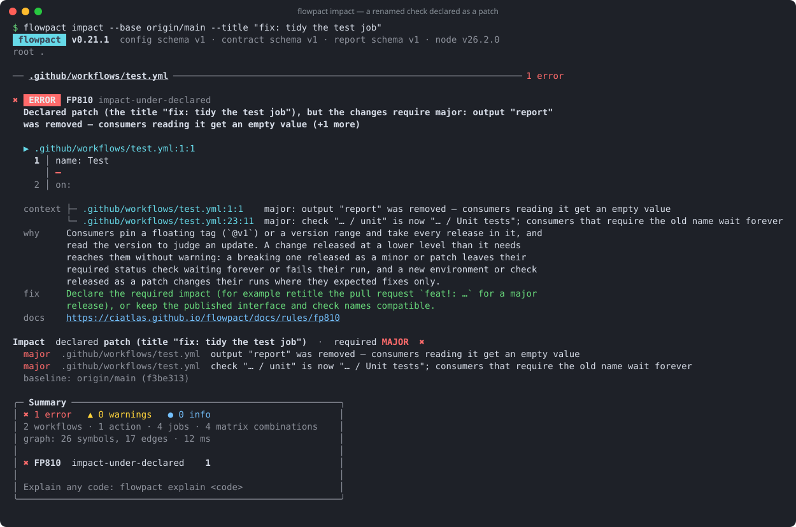
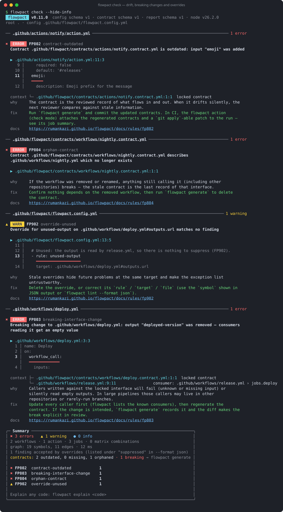
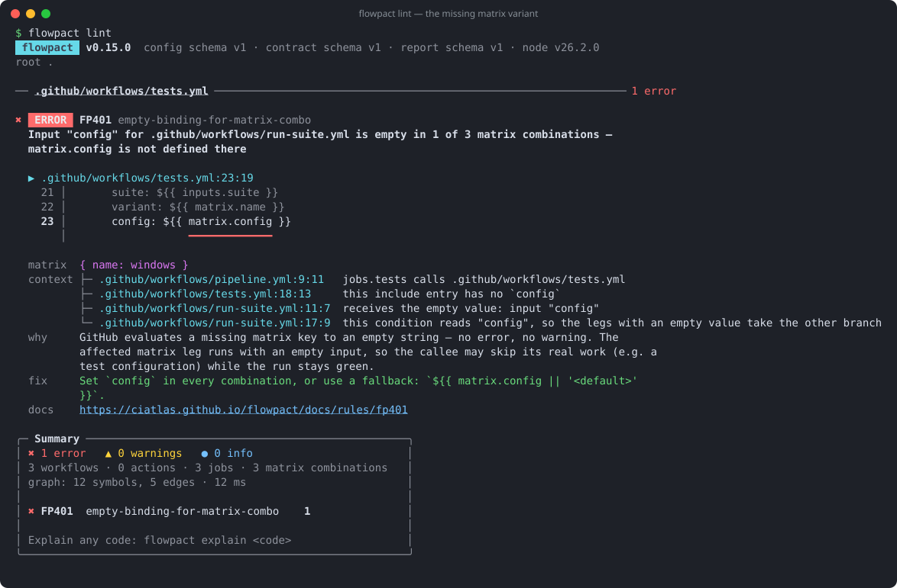
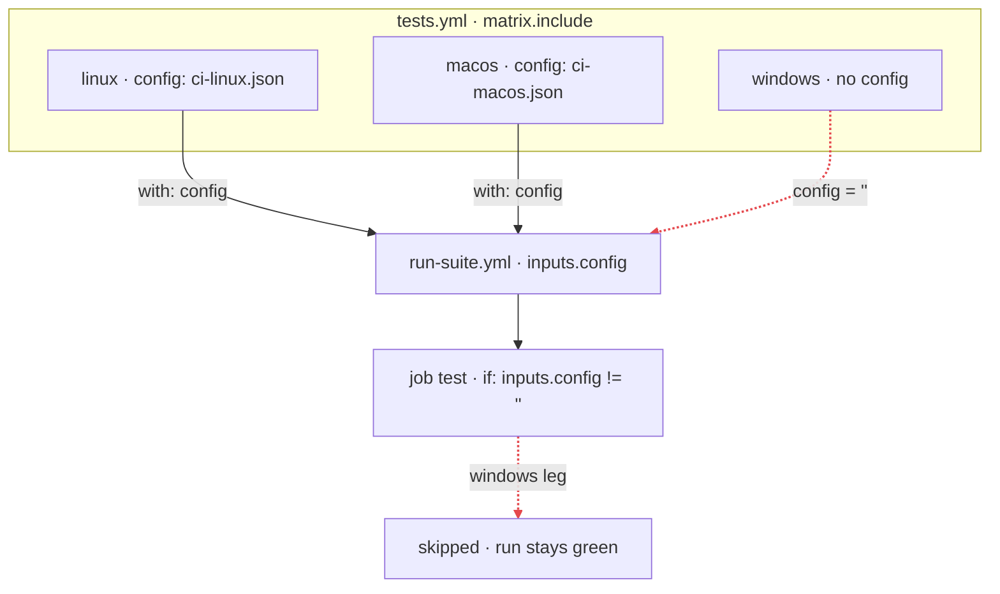

<h1 align="center">
  <picture>
    <source media="(prefers-color-scheme: dark)" srcset="assets/brand/wordmark-dark.svg">
    
  </picture>
</h1>

<p align="center">Change shared workflows and actions without breaking the repositories that use them.</p>

<p align="center">
  <a href="https://marketplace.visualstudio.com/items?itemName=flowpact.vscode-flowpact"><b>VS Code extension</b></a> ·
  <a href="https://open-vsx.org/extension/flowpact/vscode-flowpact">Open VSX</a> ·
  <a href="https://github.com/marketplace/actions/flowpact">GitHub Action</a> ·
  <a href="https://www.npmjs.com/package/flowpact">npm</a> ·
  <a href="https://ciatlas.github.io/flowpact">Docs</a>
</p>

<p align="center">
  <a href="https://github.com/ciatlas/flowpact/actions/workflows/ci.yml"></a>
  <a href="https://github.com/ciatlas/flowpact/actions/workflows/release.yml"></a>
  <a href="https://www.npmjs.com/package/flowpact"></a>
  <a href="https://www.npmjs.com/package/flowpact"></a>
  <br>
  <a href="https://scorecard.dev/viewer/?uri=github.com/ciatlas/flowpact"></a>
  <a href="https://www.bestpractices.dev/projects/15403"></a>
  <a href="https://www.bestpractices.dev/projects/15403/baseline-2"></a>
  <a href="LICENSE"></a>
</p>

**Data-flow linter for GitHub Actions.**

A reusable workflow or action is an interface: its inputs, secrets, outputs and the check names its jobs report. The
repositories that call it pin a tag such as `@v1`, and a change that breaks them raises no error where it is made.
flowpact checks both sides of that interface:

- **When you publish one,** it grades every pull request major, minor, patch or none against what callers can see,
  check names included, and fails it when its title declares less.
- **When you call one,** it checks every call against the interface of the version it targets, recorded in a lockfile,
  and grades a version bump or a tag that moved against your calls before you take it.
- **Inside a repository,** it follows every input, secret, env var, matrix key and output across workflows and actions,
  and reports where a value arrives empty while the run stays green.

It runs as a CLI, a GitHub Action and a VS Code extension, and complements actionlint.

**A job renamed in a `fix:` pull request.** Callers' branch protection requires the job's check by its name, so their
pull requests wait forever on *Expected — Waiting for status to be reported*, and a release tool ships the change to
everyone on `@v1` as a patch. Impact mode fails the pull request:



**A tag that moved.** `actions/setup-node@v6` moved to 6.1.0, which no longer has `always-auth`. A step that passes it
runs without it, with a warning in a log. flowpact grades the move against your calls, on a schedule and on the pull
request that changes the version:

```text
$ flowpact remotes update --dry-run --fail-on breaks
  changed actions/setup-node@v6: 2028fbc → 2499707, breaks 1 of 2 calls
    input "always-auth" was removed — steps that pass it get a warning, and their value is ignored
    breaks .github/workflows/release.yml:7 jobs.publish step #2
      FP102 actions/setup-node@v6 has no input "always-auth"
    1 other call fits
```

## Is this for me?

- **You publish actions or reusable workflows that other repositories use,** in public or inside your organization:
  contracts show interface changes in review and mark the breaking ones, and impact mode fails a pull request whose
  title declares less than the minor or major release its changes need
  ([how](#for-publishers-of-actions-and-reusable-workflows)).
- **You call workflows or actions from other repositories:** record their interfaces once with
  `flowpact remotes update` and commit the lockfile. flowpact then checks the inputs and secrets you pass and the
  outputs you read, and catches a version bump or a moved tag that drops an input you pass: `remotes update` says what
  each changed reference does to your calls, and the action grades the references a Renovate or Dependabot pull
  request moves ([remote interfaces](https://ciatlas.github.io/flowpact/docs/remote-interfaces)).
- **You call reusable workflows or local actions:** flowpact finds inputs callers do not pass, secrets that are never
  declared, and matrix values that are empty in some combinations.
- **You edit workflows in VS Code:** the same findings as you type, with the
  [extension](https://marketplace.visualstudio.com/items?itemName=flowpact.vscode-flowpact).

A few standalone workflows with no calls between them? actionlint alone may be enough: flowpact earns its place once
workflows call each other, or other repositories call yours.

## Get started

**In a terminal**, at the root of a repository (Node.js 22 or newer), with nothing to configure:

```sh
npx flowpact lint                       # lint .github/workflows and local actions
npx flowpact explain FP401              # why does this matter, how do I fix it?
npx flowpact trace pipeline.yml:config  # where does this input go?
npx flowpact remotes update             # record the interfaces of the remote workflows and actions you call
```

**On pull requests**, add the action; it lints by default and annotates the pull request:

```yaml
- uses: actions/checkout@v7
- uses: ciatlas/flowpact@v0.28
```

**In the editor**, install the extension from the
[Visual Studio Marketplace](https://marketplace.visualstudio.com/items?itemName=flowpact.vscode-flowpact) or
[Open VSX](https://open-vsx.org/extension/flowpact/vscode-flowpact); other editors run `flowpact lsp`.

Findings you accept go into `.github/flowpact/flowpact.config.yml` as **overrides** with a reason, an owner and an
expiry date; expired overrides bring the findings back. To accept one on its line instead, add an **ignore comment**:
`# flowpact: ignore[FP501] why`, after any version comment the line has.

📖 **Docs:** https://ciatlas.github.io/flowpact: [install](https://ciatlas.github.io/flowpact/docs/installation), a
[quickstart](https://ciatlas.github.io/flowpact/docs/getting-started),
[adopting it in an existing repository](https://ciatlas.github.io/flowpact/docs/adopting), how it works, CI and action
usage, remote interfaces, contracts, impact mode, configuration, the CLI and API, and a page for every rule.

## For publishers of actions and reusable workflows

Other repositories pin your action or reusable workflow to a tag such as `@v1`, and you cannot see their workflows or
their branch protection. Remove an output and their steps read an empty value; rename a job in a reusable workflow and
their required check waits on *Expected — Waiting for status to be reported*. Nothing fails in your repository, and neither actionlint nor
GitHub's Actions extension reports either change. flowpact puts both in the pull request:

1. **Commit the contracts.** `npx flowpact generate` writes one contract per workflow and per action in the repository
   (the root `action.yml` included) into `.github/flowpact/`: its inputs, secrets and outputs, what it calls and which
   workflows in this repository call it. Contracts are deterministic (no hashes or timestamps), so a pull request that
   changes an interface also changes a contract, and reviewers see a small YAML diff.
2. **Check every pull request.** `npx flowpact check`, or the action with `mode: check`, fails until the contracts match the
   workflows again and marks **breaking** changes, such as a removed output or a new required input. The action's job
   summary lists every change, breaking ones in bold, and the action uploads the regenerated contracts as a patch that
   contributors without Node.js can apply with `git apply`.

   

3. **Grade the release.** With `impact: auto`, the action compares each pull request with its base and grades what
   consumers can see as major, minor, patch or none: a renamed job or a removed output is major, a new optional input
   minor. It fails the pull request when its changes need a minor or major release and its Conventional Commits title
   declares less (`fix:` patch, `feat:` minor, `feat!:` major). When pull requests are squash-merged with the title as
   the commit message (*Default commit message: Pull request title* in the repository settings; GitHub's default uses
   the commit's own title when a pull request has one commit), release tools such as release-please read that title,
   so the release they cut is no smaller than the change needs. Labels can declare the impact instead, and release pull
   requests are compared with the last release tag.

```yaml
on:
  pull_request:
    # edited / labeled: re-check when the title or the labels change
    types: [opened, edited, synchronize, reopened, labeled, unlabeled]

jobs:
  flowpact:
    runs-on: ubuntu-latest
    permissions:
      contents: read
    steps:
      - uses: actions/checkout@v7
      - uses: ciatlas/flowpact@v0.28
        with:
          mode: check   # lint, and compare with the committed contracts
          impact: auto  # grade the change against the pull request title
```

See [contracts](https://ciatlas.github.io/flowpact/docs/contracts) and
[impact mode](https://ciatlas.github.io/flowpact/docs/impact-mode).

## What it finds that other tools miss

| Problem | actionlint | flowpact |
| --- | --- | --- |
| A published workflow removes an output or renames a job, which can break consumers in other repositories | — | `FP803` (against the committed contracts), `FP810` (impact mode, against the base commit) |
| A call to a reusable workflow or action in another repository passes an unknown input or leaves out a required one | popular actions only | `FP102`, `FP101`, against the [remote interfaces lockfile](https://ciatlas.github.io/flowpact/docs/remote-interfaces) |
| A version bump, or a tag that moved, drops an input a call passes | — | `flowpact remotes update` grades each changed reference against your calls; the action grades a pull request's version changes |
| One matrix `include` entry lacks a key that is passed to a reusable workflow or action | — | `FP401`, naming the combination |
| An optional input with no default is left out, so a step is skipped or a required input further down is empty | — | `FP105`, `FP107` |
| A reusable workflow that declares no secrets reads one, and a caller does not use `secrets: inherit` | — | `FP205` |
| A step runs `./.github/actions/...` after checking the repository out into a subdirectory | — | `FP606` |



*The bug that started flowpact: one matrix entry had no `config`, so that test variant never ran. actionlint
reports nothing here.*



In a large public repository, flowpact found the `FP205` case: a reusable workflow that reads `secrets.CODECOV_TOKEN`
while declaring no secrets, called from 31 places and none with `secrets: inherit`, so the token is always empty.

Both tools report a missing or unknown input on a direct call to a local reusable workflow or action, and actionlint
also checks shell scripts, runner labels, expression types, cron schedules and the inputs of popular actions such as
`actions/checkout`. Use flowpact next to it, and zizmor for security. The
[comparison](https://ciatlas.github.io/flowpact/docs/comparison) shows both tools' output side by side.

## In your editor

The [VS Code extension](https://marketplace.visualstudio.com/items?itemName=flowpact.vscode-flowpact) (also on
[Open VSX](https://open-vsx.org/extension/flowpact/vscode-flowpact)) reports the same findings as you type, traces
inputs, secrets and outputs on hover, and goes to definitions and references across workflow calls. Other editors can
use the language server, `flowpact lsp` ([editors](https://ciatlas.github.io/flowpact/docs/editors)).


## Status

Shipped: the engine, 57 rules, contracts (`flowpact generate` / `flowpact check`), impact mode, the remote interfaces
lockfile (`flowpact remotes update`, read at the commits GitHub's `actions.lock` pins) with a grade of every version
change against your calls (a drift check, and a verdict on pull requests in the action), overrides with reason and
expiry, ignore comments, plugins, the CLI (pretty, JSON, Markdown and SARIF output; `flowpact graph`, `trace`), a JavaScript API, the
GitHub Action, a language server and the
[VS Code extension](https://marketplace.visualstudio.com/items?itemName=flowpact.vscode-flowpact) (diagnostics as you
type, hover traces, go to definition across workflow calls and into the sources of remote workflows and actions,
quick fixes, rename and completion; also on [Open VSX](https://open-vsx.org/extension/flowpact/vscode-flowpact)). See
the [roadmap](https://ciatlas.github.io/flowpact/docs/roadmap).

## Security

flowpact reads the repository it analyzes as untrusted input, and its releases are built only by GitHub Actions,
signed, and published with provenance and an SBOM. It holds the
[OpenSSF Best Practices](https://www.bestpractices.dev/projects/15403) badge at the passing level and meets the
[OpenSSF Baseline](https://www.bestpractices.dev/projects/15403/baseline-2) at level 2; at level 1 it meets every
control but one, because the GitHub Action's bundle is committed to the repository so that `uses:` can run it.

- [Security](https://ciatlas.github.io/flowpact/docs/security): what flowpact reads, writes and sends, and how to
  verify a release.
- [Threat model](https://ciatlas.github.io/flowpact/docs/threat-model): its threats ranked, with the code and tests
  that defend against them.
- [Security policy](SECURITY.md): how to report a vulnerability, and the fixes in past releases.

## Feedback and contributing

Report bugs and ask for features in [GitHub Issues](https://github.com/ciatlas/flowpact/issues); report
vulnerabilities privately, as the [security policy](SECURITY.md) explains. To contribute, see
[CONTRIBUTING.md](CONTRIBUTING.md); [MAINTAINERS.md](MAINTAINERS.md) lists who maintains flowpact and who has access
to what.

## License

MIT
