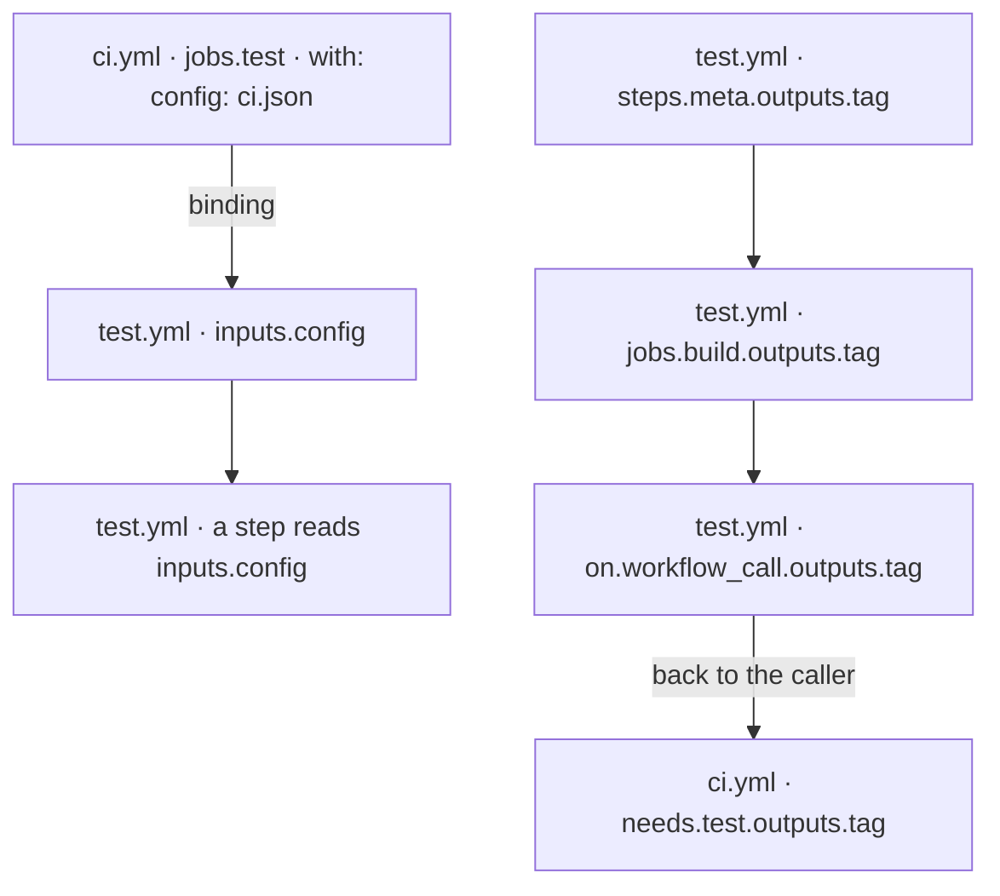

flowpact reads your workflows and local actions into a graph of where each value is defined and where it is read, then
runs rules over it. These are the terms the rest of the docs use for its parts.

## The graph

### Unit

A workflow file or a local action (an `action.yml` in the repository). flowpact loads every unit under
`.github/workflows` and every local action they use. A workflow or action in another repository becomes a unit too, but
only its interface, read from the [remote interfaces lockfile](#remote-interfaces-lockfile): its jobs and steps are not
followed.

### Symbol

Anything that holds a value, and the jobs: an input, a secret, an output, an env variable, a matrix key. Each has a
stable id, the file and its path in it, such as `.github/workflows/test.yml#inputs.config` or
`.github/workflows/ci.yml#jobs.build.outputs.version`. Findings name the symbol they are about, an
[override](#override) can name it as its `target`, and [`flowpact trace`](/docs/cli#flowpact-trace) starts from it.

### Binding

A `key: value` that passes a value on: under `with:` to a reusable workflow's or an action's input, under `secrets:`,
or under `env:`. A binding is where a caller's expression meets a callee's input, and where an empty value enters a
call.

### Combination

One job of an expanded matrix: one set of values for its keys, after `include` and `exclude`. flowpact evaluates every
binding and condition of the job once per combination of the matrices in your YAML, and a finding names the combinations
it affects, such as `{ name: windows }`. A matrix computed at run time (`fromJSON(...)`) is not expanded unless you
declare its keys under [`matrixShapes`](/docs/configuration#matrix-shapes).

### Unknown values

A value known only when the job runs, such as `github.sha` or another job's output, is *unknown*, and flowpact never
guesses it. A matrix key that a combination lacks is not unknown: it is empty, and flowpact follows it into every value
it reaches (see [How it works](/docs/how-it-works#4-expand-matrices--the-part-that-catches-silent-empties)).

### Condition and value

An expression in an `if:` is a *condition*: GitHub treats `''`, `0`, `false` and `null` as false and every other value as
true, so `if: steps.patch.outputs.file` and `if: steps.patch.outputs.file != ''` decide the same way. Under `env:`,
`with:` or `outputs:`, an expression is a *value*, passed on as it is: `a || b` gives the first operand that is true, not
`true`, and only a comparison such as `x != ''` gives `true` or `false`. An `if:` with text around its `${{ }}` is a
string, which is always true. [FP507](/docs/rules/fp507) reports a comparison with `''` that a condition does not need.

## Findings

### Finding

What a rule reports: a code such as `FP401`, a severity (error, warning or info), the location, the call chain that
leads there, the matrix combinations it affects, why it matters and how to fix it. Each [rule](/docs/rules) has a page.
A finding keeps its fingerprint when unrelated lines move.

### Override

A finding you accept, recorded in the [config](/docs/configuration#overrides) with a reason, and optionally an expiry
date and an owner. An accepted finding is listed apart, with the reason; when the date passes it comes back
(`FP901`).

### Base config

A config with defaults for many repositories, such as an organization's, passed with `--base-config` or the action's
`base-config` input. Each repository's own config goes on top of it ([Base config](/docs/configuration#base-config)).

### Generated file

A workflow or action written by a tool, recognized by a header comment such as `DO NOT EDIT` or `@generated`, by the
`.lock.yml` suffix, or by the config ([Generated files](/docs/configuration#generated-files)). flowpact still checks how
it calls other units and how they call it, but does not report on its internals: the next generation would overwrite a
fix.

## Publishing workflows and actions

### Published unit

A unit other repositories can use: every reusable workflow (`on: workflow_call`) but those whose file name starts with
`_`, and the action at the repository's root; or, when it is set, the units
[`impact.publish`](/docs/impact-mode#what-is-graded) lists. Renaming one of their jobs or removing one of their outputs
breaks callers you cannot see.

### Contract

A generated file per workflow and local action in `.github/flowpact/contracts/` that records what it accepts, what it
returns, what it calls and who calls it. You commit them, and [`flowpact check`](/docs/contracts) fails when the
workflows no longer match: that is **drift**. Each change is graded **breaking**, such as a removed output or a new
required input, or not.

### Baseline, required and declared impact

[Impact mode](/docs/impact-mode) compares a pull request with its **baseline**, usually the base branch. From the changes
to published units it computes the **required** impact (major, minor, patch or none), and compares it with the
**declared** one, by default from the Conventional Commits title. It fails when the declared impact is less.

## Other repositories

### Remote reference

A `uses:` of a workflow or action in another repository: `octo/ship/.github/workflows/deploy.yml@v1`, `octo/setup@v2`.
Its `@ref` is a tag, a branch or a commit SHA.

### Remote interfaces lockfile

`.github/flowpact/remotes.lock.yaml`, written by [`flowpact remotes update`](/docs/remote-interfaces): the inputs,
secrets and outputs of each remote reference, at the commit it resolved to. Runs read only this committed file, so they
check remote calls without the network.

### actions.lock

GitHub's own lockfile, `.github/workflows/actions.lock`, which pins the commit each remote reference runs. flowpact reads
it, to check a reference at the commit that runs (see
[GitHub's actions.lock](/docs/remote-interfaces#githubs-actionslock)).

### Version change and verdict

A remote reference that moves to another commit, by a moved tag or a bump to another version. flowpact grades it
against every call of the reference, and each call gets a **verdict**: it *breaks* (a check fails with the new interface
that passed with the old one), it is *not fully checked* (part of the change is beyond the checks), or it *fits* (see
[When a version changes](/docs/remote-interfaces#when-a-version-changes)).

### Sources cache

Where `flowpact remotes update` and `remotes download` keep the remote workflow files and `action.yml`s they read, so the
editor can open them ([Sources for the editor](/docs/remote-interfaces#sources-for-the-editor)).
