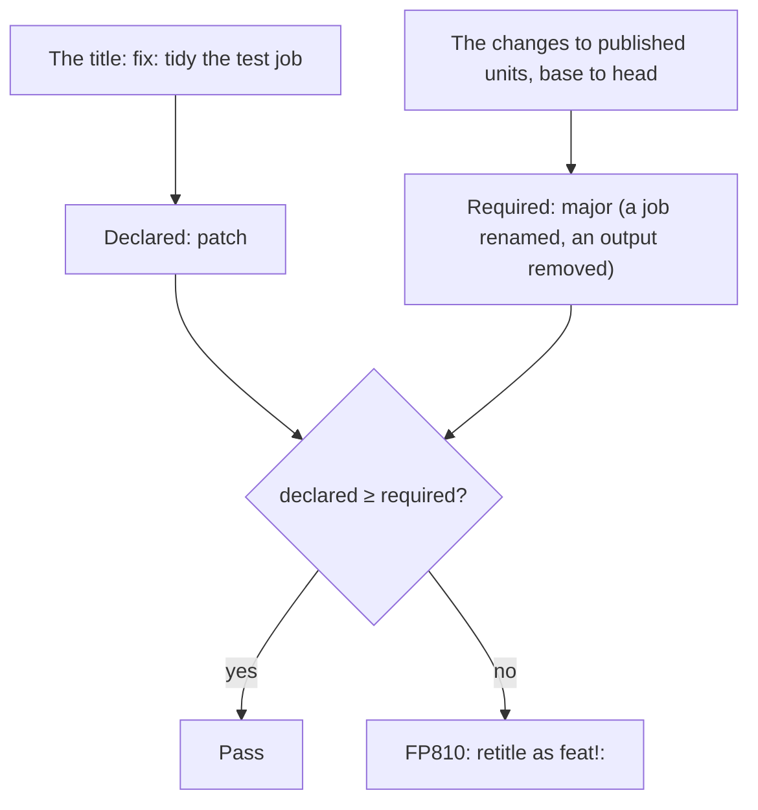

Impact mode fails a pull request that declares a smaller release than its changes need, such as a `fix:` title on a
change that renames a job or removes an output of a published reusable workflow.

It grades every change callers can see as **major, minor, patch or none**, and compares that with the declared impact:
by default the pull request's Conventional Commits title, which release tools such as release-please read from the
squash commit. In the GitHub Action, turn it on with `impact: auto` ([setup](#github-action)).

Callers pin a tag such as `@v1` and take every release in it. Rename a job, and their branch protection waits forever
for the old check name (_Expected — Waiting for status to be reported_), while nothing fails in your repository.

```sh
flowpact impact --base origin/main --title "fix: tidy the test job"
```

<Screenshot name="impact" alt="flowpact impact failing with FP810: declared patch (the title “fix: tidy the test job”), but a removed output and a renamed check in test.yml require major" caption="A fix: title on a change that requires a major release." />



## What is graded

Only **published** units, the ones other repositories call:

- every reusable workflow (`on: workflow_call`), except files whose name starts with `_` (`_build.yml`), the
  convention for internal ones;
- the action at the repository's root (`action.yml`, what `uses: owner/repo@ref` runs);
- or, instead, what [`impact.publish`](#configuration) lists, such as `*/action.yml` in a repository of several actions
  (`**/action.yml` includes the root one).

Your own CI workflows and `.github/actions/**` are not graded. An internal workflow counts where a published one calls
it, since its check names appear under the caller's.

| Change to a published unit | Required impact |
| --- | --- |
| A check name is gone: a job renamed or removed, its id changed when it has no `name`, a matrix key or value changed or removed, `${{ }}` added to or removed from `name`, a nested call removed | major |
| Job id renamed, check name unchanged | none |
| A new check name (a new job or matrix value) | minor |
| `workflow_call` input or secret removed, made required or added as required, input type changed, choice option removed | major |
| Output removed (callers read `''`) | major |
| An artifact uploaded with `actions/upload-artifact`, by the unit or by what it runs, is no longer uploaded under that name: a caller's job that downloads it fails | major (uncertain when the name is chosen at run time) |
| An output set on every run is now set only when an `if:` that reads a context holds: callers read `''` otherwise | major, uncertain ([`FP814`](/docs/rules/fp814)) |
| Optional input, secret or output added | minor |
| Input default changed | minor |
| Reusable workflow or action moved or deleted, or `workflow_call` removed | major |
| A published unit no longer parses | major |
| A job, its own or a called workflow's, needs a new or higher `permissions:` scope: callers that grant less fail when the run starts. A job that calls a workflow and sets `permissions:` (or whose workflow does) requests them for all of it, so only its own count | major |
| Action `runs.using` changed (`node20` → `node24`) | major |
| A job, its own or a called workflow's, needs a runner label or group it did not need (`[self-hosted, gpu]`): callers without one never start it | major |
| A job's runners are now chosen at run time (`runs-on: ${{ inputs.runner }}`) | major, uncertain ([`FP814`](/docs/rules/fp814)) |
| Another GitHub-hosted image (`ubuntu-22.04` → `ubuntu-24.04`), or fewer runner labels | patch |
| A job gains, changes or loses its `environment:`: the caller's environment of that name, its protection rules and secrets, now applies or no longer does | minor (uncertain when the name is chosen at run time) |
| A new third-party action or workflow inside a published unit: callers' allow-lists and SHA-pinning policies apply | minor |
| Nothing above, but the jobs or steps changed, the unit's or those of what it runs (comments, formatting and key order aside) | patch |
| Narrower permissions, descriptions, `workflow_dispatch` inputs | none |

Callers' branch protection is not visible from your repository, so every check name a published workflow reports counts
as required. Names are compared [as GitHub forms them](#how-check-names-are-formed). A name built from the workflow's
inputs is compared by its template: `Test ${{ inputs.os }}` → `Tests ${{ inputs.os }}` is a rename,
whatever callers pass.

### Only some units

```sh
flowpact impact actions/deploy --base origin/main --title "$PR_TITLE"
```

Paths (files or directories) grade only the published units within them. `flowpact impact`, `lint --impact` and
`check --impact` take them, as do the action's `paths` input and the [API](/docs/api). Use them where each unit is
released on its own, such as one job per action. **This narrows the gate**: a breaking change outside the paths passes.

Prefer directories (`actions/`) to files. A removed or renamed unit is graded only when its old path is among the
paths: after a move from `actions/old` to `actions/new`, `flowpact impact actions/new` grades the new unit (minor) but
not the removal (major).

<Accordions type="multiple">
<Accordion title="A path that names only a removed unit" id="removed-unit-path">

A path such as `actions/old` serves the pull request that removes it. Once that is merged, the baseline lacks the unit
too, so the path names nothing, and later runs fail on it until it is taken out. A directory that holds other units,
such as `actions/`, keeps working.

</Accordion>
<Accordion title="Paths when impact mode is skipped" id="paths-when-skipped">

On `merge_group`, and on a `push` with no commit before it or with `impact: auto` and no `base-ref`, there is no
baseline to tell a removed path from a typo. A missing path, or one with no workflow or action left in it, is then a
warning, not an error. The pull request's run usually refuses it first, but not on a new branch's first push or in a
workflow that runs only on `push`: use `impact: on` there, which compares each push with the commit before it (all but a
new branch's first). On the other events without a baseline, such a path is refused.

</Accordion>
<Accordion title="Units that ignore leaves out" id="ignored-units">

A published unit is left out when both the **baseline's** and the pull request's
[`ignore`](/docs/configuration#reference) match it. A pull request's own `ignore` edit never lets a change through: a
unit it adds is graded until the edit is merged (the run notes `impact: this pull request changes what ignore leaves out
of impact mode (…); that applies after it is merged`), and one it removes is graded at once. Every other finding follows
the pull request's own `ignore`.

When `ignore` leaves out every published unit, nothing is graded. `impact: auto` skips the run, saying why; `impact: on`
and the CLI still check the declaration against a required impact of `none`, so a label that declares more than the
title is still `FP811`.

</Accordion>
<Accordion title="Where findings about the declaration go" id="declaration-findings">

`FP811`–`FP813` point at no change, so they go on the first published file graded, else the first workflow or action
file `ignore` leaves in (within the paths). With neither, impact mode is skipped and says why, such as `impact: skipped
(nothing within the paths to grade or to report on)`.

</Accordion>
<Accordion title="What the reports say" id="reports-with-paths">

The terminal and Markdown reports add `only within <paths>: graded <units>`, and `left out by ignore: <units>` when
`ignore` left out published units. The JSON report's `impact.scope` lists the `paths` and the `units` graded, and
`impact.ignored` the units left out.

</Accordion>
</Accordions>

## Where the declared impact comes from

Exactly one source is **authoritative** (`impact.declaredBy`): the one your release tool reads.

| Source | From | Means |
| --- | --- | --- |
| `explicit` | `--expect`, action input `expected-impact` | as given |
| `title` (default) | `--title`, or the pull request title in GitHub Actions | `type!:` → major, `feat` → minor, `fix` / `perf` → patch, other types → none |
| `labels` | `--labels`, or the pull request labels in GitHub Actions | `semver:major` / `semver:minor` / `semver:patch` / `semver:none` |

- The **title** describes the squash commit. A title that is not a Conventional Commit is _not declared_, even when a
  `semver:*` label is set.
- **Other sources are advisory.** One that declares more (a `semver:major` label on a `fix:` title) is an error: the
  release tool would cut a patch.
- **Release pull requests** (release-please's `chore(main): release 0.3.0`, or the `autorelease: pending` label)
  compare everything since the **last release tag** with the proposed version. release-please's settings for the root
  package apply: `bump-minor-pre-major` (before 1.0, `0.2.0` → `0.3.0` is a major release),
  `bump-patch-for-minor-pre-major`, `include-v-in-tag` and component tags (`my-action-v0.2.0`).
- Without a declaration, flowpact reports the required impact (`FP813`) and does not fail.

Declaring more than needed is never an error, since a release may hold changes flowpact does not grade. Nor is a
`patch` change under a `none` declaration.

## Findings

| Code | Severity | Reported when |
| --- | --- | --- |
| [`FP810`](/docs/rules/fp810) `impact-under-declared` | error | The changes require more than declared (at least minor). |
| [`FP811`](/docs/rules/fp811) `impact-declaration-conflict` | error | An advisory source declares more than the authoritative one. |
| [`FP812`](/docs/rules/fp812) `impact-over-declared` | info | The declaration is bigger than the changes require. |
| [`FP813`](/docs/rules/fp813) `impact-undeclared` | info | Nothing is declared; the required impact is reported. |
| [`FP814`](/docs/rules/fp814) `impact-uncertain` | warning | A change depends on something flowpact cannot evaluate (a check name built from `vars` or the event, a runtime matrix, an output that is now set only when an `if:` holds). Not counted unless `impact.uncertain: fail`. |

## The baseline

| Run | Compared with |
| --- | --- |
| `--base <ref>` / action input `base-ref` | that ref |
| `pull_request` | the base commit of the pull request |
| `push` | the commit before the push (a new branch or tag is skipped) |
| release pull request | the last release tag (see above) |
| anything else | `origin/HEAD`, else `origin/main`, else `origin/master` |

`merge_group` runs are skipped (the pull request was checked), and so is a run whose baseline is the checked-out
commit.

## Using it

### GitHub Action

```yaml
on:
  pull_request:
    # edited / labeled: re-check when the title or the labels change
    types: [opened, edited, synchronize, reopened, labeled, unlabeled]

jobs:
  flowpact:
    runs-on: ubuntu-latest
    permissions:
      contents: read
    steps:
      - uses: actions/checkout@v7
      - uses: ciatlas/flowpact@v0.25
        with:
          impact: auto   # off (default) | auto | on
```

- `auto` turns impact mode on for pull requests in repositories that publish a workflow or action. With the `paths`
  input, it skips a run when none is within them.
- On a shallow checkout, the action fetches the base commit (and the release tags, for a release pull request) itself.
  `contents: read` is enough, and `persist-credentials: false` works.
- The job summary gets an **Impact** section, and the outputs `required-impact`, `declared-impact` and `impact-ok` let
  later steps react.
- Use `pull_request`. flowpact refuses `pull_request_target`, which checks out the default branch.

### CLI

```sh
flowpact impact --base origin/main --title "$PR_TITLE"     # only the impact verdict
flowpact check --impact --base origin/main --expect minor  # everything check does, plus impact
```

| Option | Description |
| --- | --- |
| `[paths…]` | Grade only the published workflows and actions within these files or directories ([Only some units](#only-some-units)). Default: every published one. |
| `--base <ref>` | Baseline (default: the pull request base in GitHub Actions, else `origin/HEAD`). It must be in the clone (`git fetch`). |
| `--expect <level>` | Declared impact: `none`, `patch`, `minor` or `major`. |
| `--title <text>` | Pull request title to read the declaration from. |
| `--labels <a,b>` | Pull request labels. |

`--format json` adds an `impact` section to the report: the baseline, the required and declared impact, `ok`, and every
graded change.

### Configuration

```yaml title=".github/flowpact/flowpact.config.yml"
impact:
  publish: [.github/workflows/reusable-*.yml, '*/action.yml'] # what other repositories use
  declaredBy: title                                            # explicit | title | labels
  labels: { major: breaking, minor: enhancement }              # label names per level
  types: { feat: minor, fix: patch, perf: patch, deps: patch } # Conventional Commits types
  uncertain: warn                                              # warn | fail
```

The impact settings are read from the **baseline**, so a pull request cannot relax its own check: changed settings apply
once it is merged. `ignore` counts only where both sides match it ([above](#only-some-units)). A
[base config](/docs/configuration#base-config) applies under the baseline's config too, and alone when the baseline has
no valid config.

<Accordions>
<Accordion title="How a base config counts on each side" id="base-config-sides">

It depends on whether the pull request's commits can change it:

- **Outside the repository, or a file no commit tracks** (an organization's config checked out into a gitignored
  directory): no commit can change it, so it applies on both sides, `ignore` included.
- **A file of the checked-out commit** is the pull request's version, so the baseline's impact settings leave it out.
  Its `ignore` counts on the baseline's side as the baseline has it: an edit applies after the merge. A symbolic link
  on the way counts as the baseline has it too.
- **A file within a submodule** counts the same way, read at the baseline's commit of the submodule. Once merged, the
  commit the pull request records applies, not one checked out in its place (`git submodule update --remote`). When
  the clone lacks either commit (a submodule checked out at depth 1; use `fetch-depth: 0`), that side's `ignore`
  leaves nothing out, and the run says so.

</Accordion>
</Accordions>

## How check names are formed

Verified against the check runs GitHub reported for a lab repository with one workflow per case
(`fixtures/checknames-lab`; a test requires an exact match):

- A job's check name is its `name:`, trimmed, or the job id when it has no name or a blank one. The workflow name and
  file name are not part of it.
- A matrix job gets the suffix ` (value1, value2)`, unless its name is dynamic: text around an expression
  (`Lit ${{ 'X' }}`) or an expression that reads anything (`${{ matrix.os }}`) gets none, so such names can collide. A
  name that is a single literal expression (`${{ 'Only' }}`) keeps the suffix.
- The suffix lists the matrix dimensions in declared order. Keys an `include` adds to existing combinations are not
  shown; combinations an `include` creates show all their values. `null` and `''` are skipped, objects and arrays are
  flattened, and numbers are formatted like .NET (`3.10` → `3.1`, `1e15` → `1E+15`).
- A job in a called workflow reports `caller job / callee job`, with one more ` / ` per nesting level. Callee names can
  read the caller's `with:` values.
- A job skipped by its `if:`, or because a job it needs failed, reports **one** check with its raw name, and a skipped
  caller reports no ` / callee` checks at all.
