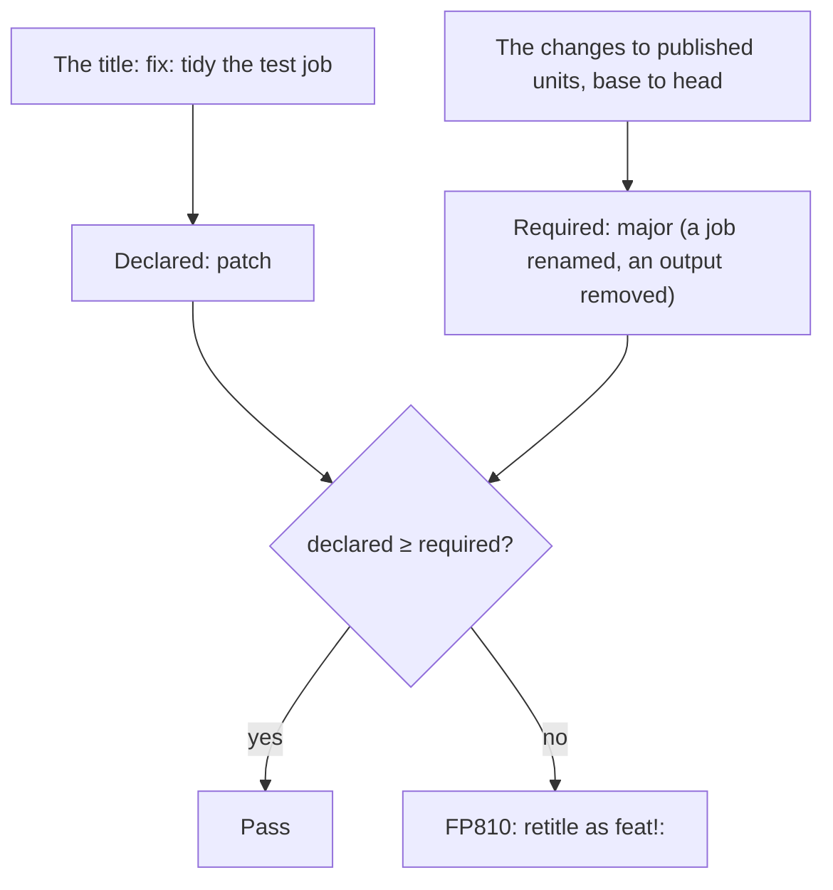

Impact mode fails a pull request that declares less than the minor or major release its changes need, such as a `fix:`
title on a pull request that renames a job or removes an output of a published reusable workflow. It compares the pull
request with its base, grades every change consumers can observe as **major, minor, patch or none**, and checks that
against the declared impact: by default the Conventional Commits title, which release tools such as release-please read
when pull requests are squash-merged with the title as the commit message. In the GitHub Action, turn it on with
`impact: auto` ([setup](#github-action)).

Consumers pin a floating tag (`@v1`) and take every release in it, and some changes break them without any error in the
publishing repository. The classic one is renaming a job: consumers' branch protection requires the check `ci / Test`,
the job now reports `ci / Unit tests`, and their pull requests wait forever on _Expected — Waiting for status to be
reported_.

```sh
flowpact impact --base origin/main --title "fix: tidy the test job"
```

<Screenshot name="impact" alt="flowpact impact failing with FP810: declared patch (the title “fix: tidy the test job”), but a removed output and a renamed check in test.yml require major" caption="A fix: title on a change that requires a major release." />



## What is graded

Only **published** units:

- every reusable workflow (`on: workflow_call`), except files whose name starts with `_`
  (`.github/workflows/_build.yml`), the convention for internal ones;
- the repository's own action (`action.yml` at the root — what `uses: owner/repo@ref` runs);
- the units listed in [`impact.publish`](#configuration) (for example `*/action.yml` in a repository of several
  actions). Setting `impact.publish` replaces the defaults. `**/` also matches no directory, so `**/action.yml`
  includes the root action.

Workflows that only run the repository's own CI, `_`-prefixed reusable workflows, and `.github/actions/**` are not
graded: renaming your own CI jobs is not a change your consumers can see. Internal workflows still count where a
published one calls them — their check names appear under the caller's.

| Change to a published unit | Required impact |
| --- | --- |
| A check name a reusable workflow reports is gone: job renamed, job id changed when there is no `name`, matrix key changed or value removed, `${{ }}` added to or removed from `name`, job or nested call removed | major |
| Job id renamed while its check name stays the same | none |
| A new check name (matrix value added, new job) | minor |
| `workflow_call` input or secret removed, optional → required, new required input or secret, input type changed, choice option removed | major |
| Output removed (callers silently read `''`) | major |
| An artifact the unit uploaded with `actions/upload-artifact` — in its own steps, a local action it uses or a workflow it calls — is no longer uploaded under that name (they run in the caller's run, so a caller's later job that downloads it by name fails) | major (uncertain when a name is now chosen at run time) |
| An output set on every run is now set only under a condition: the job or step it comes from (or a job that one needs) gains an `if:` that reads a context, so callers read `''` on runs where it is false | major, uncertain ([`FP814`](/docs/rules/fp814)) |
| Optional input, secret or output added | minor |
| Input default changed | minor |
| Reusable workflow moved or deleted, or `workflow_call` removed; action moved or deleted | major |
| A published unit no longer parses | major |
| A job requests a new or higher `permissions:` scope — its own, the workflow-level ones it inherits, or a called workflow's job's (callers that grant less fail when the run starts) | major |
| Action `runs.using` changed (for example `node20` → `node24`) | major |
| A job — its own, or a called workflow's — needs a runner label or runner group it did not need before (`ubuntu-latest` → `[self-hosted, gpu]`, a new job on such runners): it runs on the caller's runners, and callers without one never start it | major |
| A job's runners are chosen at run time (`runs-on: ${{ inputs.runner }}`) where they were not, or by another expression | major, uncertain ([`FP814`](/docs/rules/fp814)) |
| Another GitHub-hosted image (`ubuntu-22.04` → `ubuntu-24.04`), or fewer runner labels | patch |
| A job gains, changes or loses its `environment:` (a called workflow's job deploys to the caller's environment of that name: GitHub creates a missing one, so nothing fails, but its protection rules and secrets now apply, or no longer do) | minor (uncertain for a name chosen at run time) |
| A new third-party action or workflow used inside a published unit (organization allow-lists and SHA-pinning policies apply to consumers) | minor |
| Nothing above, but the unit's jobs or steps changed, or those of a local action or internal workflow it runs (comments, formatting and key order aside): callers' runs may do something else | patch |
| Narrower permissions, descriptions, `workflow_dispatch` inputs | none |

Consumers' branch protection is not visible from the publishing repository, so every check name a published reusable
workflow reports counts as one a consumer may require. Names are compared the way GitHub forms them — see
[how check names are formed](#how-check-names-are-formed). A name that reads the reusable workflow's own inputs
depends on what each consumer passes, so it is compared by its template: `Test ${{ inputs.os }}` becoming
`Tests ${{ inputs.os }}` is a rename whatever the consumer passes.

### Only some units

```sh
flowpact impact actions/deploy --base origin/main --title "$PR_TITLE"
```

Paths (workflow or action files, or directories) narrow impact mode to the published units within them, wherever it
runs: `flowpact impact <paths>`, `flowpact lint --impact <paths>` and `flowpact check --impact <paths>`, the action's
`paths` input with `impact`, and the `paths` option of the [API](/docs/api). Without paths, every published unit is
graded.

- Only the published units within the paths are graded, and the required impact, `ok` and the findings are about them
  alone. **This narrows the gate**: a breaking change to a published unit outside the paths passes. Use it where each
  unit is released on its own, such as one job per action in a repository of several actions.
- A unit is within a path when its file is that file or lies in that directory, in the working tree or in the
  baseline. A path the pull request removed (`actions/old`) grades that removal, as a major change.
- A removed or renamed unit is graded only when its old path, or a directory holding it, is among the paths. After a
  move from `actions/old` to `actions/new`, `flowpact impact actions/new` grades only the new unit (minor), not the
  removal (major): give both paths, or their parent `actions/`. Prefer directory paths, above all in the action's
  `paths` input: a pull request that deletes a unit and drops its path from the input is never graded for the removal.
- A path that names only a removed unit (`actions/old/action.yml`, or `actions/old`) serves the pull request that
  removes it, not later ones: once the removal is merged, the baseline lacks the unit too, so the path names nothing
  any more, and the runs of later pull requests fail on it until it is taken out of the paths. A directory that also
  holds other units, such as `actions/`, keeps working: another reason to prefer it.
- When impact mode is skipped on `merge_group` or `push` (a push without a commit before it, or `impact: auto`
  without `base-ref`), there is no baseline to tell a removed path from a mistake, so a path the working tree lacks,
  or one left without a workflow or action (a removed action's directory that keeps its README or `dist/`), is a
  warning there, not an error, and so is a mistyped path. These events usually follow a pull request's run, which has
  the baseline and refuses a path that never held one, but not always: the first push of a new branch comes before any
  pull request, and a workflow that runs only on `push` with `impact: auto` never refuses a mistyped path. To have it
  refused there, use `impact: on`, which compares each push with the commit before it (a new branch's first push,
  which has none, still only warns). On the other events (`pull_request_target`, `schedule` or `workflow_dispatch`
  without a baseline, or a local run whose baseline is the checked-out commit), a skipped impact mode refuses such a
  path, as a run without impact mode does.
- Units within the paths that are not published (an internal workflow, an action `impact.publish` does not list) are not
  graded. With no published unit there, the required impact is `none`.
- Files [`ignore`](/docs/configuration#reference) matches are left out the same way, with or without paths, when both
  the **baseline's** config and the pull request's match them: such a published unit is not graded, so neither the
  verdict nor the findings are about it. Matching both means that a pull request's own `ignore` edit never lets a
  change through: one that adds a published unit to `ignore` is still graded for it until the edit is merged (the run
  notes `impact: this pull request changes what ignore leaves out of impact mode (…); that applies after it is
  merged`), and one that takes a unit out of `ignore` is graded for it at once. The note names a unit only when the
  pull request's `ignore` matches every file it has once merged: after a move from `action.yml` to `action.yaml`,
  adding the old file leaves nothing out, and adding the new one leaves the unit out. Every other finding follows the
  pull request's own `ignore`.
- When `ignore` leaves out every published unit (within the paths), nothing is graded. `impact: auto` then skips the
  run, as in a repository that publishes nothing: `impact: the baseline's and the pull request's ignore leave out
  every published workflow and action (…); see ignore`, or with paths `impact: skipped (every published workflow or
  action within the paths is ignored; see ignore)`. `impact: on` and the CLI still run wherever there is a file to
  report on (see the next point): the required impact is `none`, and the declaration is still checked, so a label
  that declares more than the title is still `FP811`.
- Findings about the declaration that no change points at (`FP811`–`FP813`) go on a file impact mode looks at: the
  first published file graded, else the first workflow or action file that `ignore` does not leave out (within the
  paths, when there are paths). When there is neither, there is nothing to grade or to report on, and impact mode is
  skipped, saying why: `impact: skipped (every workflow and action within the paths is ignored: nothing to grade or to
  report on)` when `ignore` leaves out every workflow and action the paths hold, `impact: skipped (nothing within the
  paths to grade or to report on)` when they hold only what the change removed (say, an unpublished workflow), or
  without paths `impact: skipped (every workflow and action is ignored: nothing to grade or to report on)`.
- The reports say so: the terminal and Markdown reports add `only within <paths>: graded <units>`, and the JSON
  report's `impact.scope` lists the `paths` and the `units` graded. When `ignore` left out published units, they add
  `left out by ignore: <units>` (and say `no changes to the published workflows or actions that ignore leaves in`
  where nothing graded changed), and the JSON report's `impact.ignored` lists them. A unit moved to a file that
  `ignore` does not match (`b/action.yml` to `b/action.yaml` under `ignore: [b/action.yml]`) is graded, so it is not
  among them.

## Where the declared impact comes from

The declared impact must be what the release tool will read, so exactly one source is **authoritative**
(`impact.declaredBy`):

| Source | From | Means |
| --- | --- | --- |
| `explicit` | `--expect`, action input `expected-impact` | as given |
| `title` (default) | `--title`, or the pull request title in GitHub Actions | `type!:` → major, `feat` → minor, `fix` / `perf` → patch, other types → none |
| `labels` | `--labels`, or the pull request labels in GitHub Actions | `semver:major` / `semver:minor` / `semver:patch` / `semver:none` |

- The **title** describes the squash commit, so it is the right source when pull requests are squash-merged with the
  title as the commit message. A title that is not a Conventional Commit counts as _not declared_.
- **Other sources are advisory.** A higher advisory declaration (a `semver:major` label on a `fix:` title) is an
  error: the release tool would cut a patch.
- **Labels never stand in for a missing title.** With `declaredBy: title`, a title that is not a Conventional Commit
  is _not declared_ even when the pull request has a `semver:*` label.
- **Release pull requests** (a release-please title `chore(main): release 0.3.0`, or the `autorelease: pending` label)
  compare everything since the **last release tag** with the proposed version. release-please's settings for the
  root package are respected — `bump-minor-pre-major` (before 1.0, `0.2.0` → `0.3.0` is a major release),
  `bump-patch-for-minor-pre-major`, `include-v-in-tag` and component tags (`my-action-v0.2.0`), at the top level or
  under `packages["."]`.
- Without a declaration, flowpact reports the required impact (`FP813`) and does not fail.

Over-declaring is never an error — a release may contain changes flowpact does not grade — and a `patch` change in a
pull request that declares `none` does not fail either.

## Findings

| Code | Severity | Reported when |
| --- | --- | --- |
| [`FP810`](/docs/rules/fp810) `impact-under-declared` | error | The changes require more than declared (at least minor). |
| [`FP811`](/docs/rules/fp811) `impact-declaration-conflict` | error | An advisory source declares more than the authoritative one. |
| [`FP812`](/docs/rules/fp812) `impact-over-declared` | info | The declaration is bigger than the changes require. |
| [`FP813`](/docs/rules/fp813) `impact-undeclared` | info | Nothing is declared; the required impact is reported. |
| [`FP814`](/docs/rules/fp814) `impact-uncertain` | warning | A change depends on something flowpact cannot evaluate (a check name built from `vars` or the event, a runtime matrix, an output that is now set only when an `if:` holds). Not counted unless `impact.uncertain: fail`. |

## The baseline

| Run | Compared with |
| --- | --- |
| `--base <ref>` / action input `base-ref` | that ref |
| `pull_request` | the base commit of the pull request |
| `push` | the commit before the push (a new branch or tag is skipped) |
| release pull request | the last release tag (see above) |
| anything else | `origin/HEAD`, else `origin/main`, else `origin/master` |

`merge_group` runs are skipped (the pull request was checked), and so is a run whose baseline is the checked-out
commit.

## Using it

### GitHub Action

```yaml
on:
  pull_request:
    # edited / labeled: re-check when the title or the labels change
    types: [opened, edited, synchronize, reopened, labeled, unlabeled]

jobs:
  flowpact:
    runs-on: ubuntu-latest
    permissions:
      contents: read
    steps:
      - uses: actions/checkout@v7
      - uses: ciatlas/flowpact@v0.22
        with:
          impact: auto   # off (default) | auto | on
```

`auto` turns impact mode on for pull requests in repositories that publish workflows or actions, unless `ignore`
leaves out every one of them (both the baseline's and the pull request's match it). The action fetches
the base commit (and, for release pull requests, the release tags) when the checkout is shallow, with a one-off
authorization header — `persist-credentials: false` works, and `contents: read` is enough. The job summary gets an
**Impact** section, and the outputs `required-impact`, `declared-impact` and `impact-ok` let later steps react.
Use `pull_request`, not `pull_request_target`: the latter checks out the default branch, so flowpact refuses it.
With the `paths` input, impact mode grades only the published workflows and actions within those paths
([Only some units](#only-some-units)), and `auto` skips a run when none is within them.

### CLI

```sh
flowpact impact --base origin/main --title "$PR_TITLE"     # only the impact verdict
flowpact check --impact --base origin/main --expect minor  # everything check does, plus impact
```

| Option | Description |
| --- | --- |
| `[paths…]` | Grade only the published workflows and actions within these files or directories ([Only some units](#only-some-units)). Default: every published one. |
| `--base <ref>` | Baseline (default: the pull request base in GitHub Actions, else `origin/HEAD`). It must be in the clone (`git fetch`). |
| `--expect <level>` | Declared impact: `none`, `patch`, `minor` or `major`. |
| `--title <text>` | Pull request title to read the declaration from. |
| `--labels <a,b>` | Pull request labels. |

`--format json` adds an `impact` section (baseline, required, declared, `ok` and every graded change) to the report;
with paths, its `scope` lists them and the published units graded within them, and `ignored` lists the published units
`ignore` left out.

### Configuration

```yaml title=".github/flowpact/flowpact.config.yml"
impact:
  publish: [.github/workflows/reusable-*.yml, '*/action.yml'] # what other repositories use
  declaredBy: title                                            # explicit | title | labels
  labels: { major: breaking, minor: enhancement }              # label names per level
  types: { feat: minor, fix: patch, perf: patch, deps: patch } # Conventional Commits types
  uncertain: warn                                              # warn | fail
```

The impact settings are read from the **baseline** (the same `--config` path, or the default locations), so a pull
request cannot relax its own check; changed settings apply once it is merged. As far as impact mode goes, `ignore` is
read from both sides: it leaves out only the published units that both the baseline's and the pull request's `ignore`
match, so an edit to it can neither take a unit out of the check nor slip a change through ([Only some
units](#only-some-units)). A
[base config](/docs/configuration#base-config) applies under the baseline's config too. When the baseline has no config,
or an invalid one, the base config's settings apply, or the defaults without one. How a base config counts depends on
whether the pull request's commits can change it:

- **Outside the repository, or a file of the working tree that no commit tracks**, such as the organization's config
  checked out into a gitignored directory, or one generated within a submodule: no commit of the pull request can
  change it, so it applies on both sides, `ignore` included. A published unit it ignores is left out, with no note.
- **A file of the checked-out commit** is the pull request's own version of it, so the baseline's impact settings
  leave it out. Its `ignore` counts on the baseline's side as the baseline has it (read from git): a base config the
  pull request leaves alone ignores the same on both sides, and what one it edits adds to `ignore` applies after it is
  merged. A symbolic link on the way counts as the baseline has it too, so pointing a tracked link at another config,
  or putting one in place of a directory on the way, is graded like editing the config.
- **A file within a submodule** counts like a file of the checked-out commit, read at the baseline's commit of the
  submodule: moving the submodule to a version that ignores more is graded until the pull request is merged. What
  applies once merged is the commit the pull request records for the submodule, not another one checked out in its place
  (`git submodule update --remote`): a published unit is left out only when that commit's `ignore` matches it too. When
  that commit has no base config there, its `ignore` leaves nothing out, and the run says `impact: the pull request's
  commit of the submodule … has no base config …`. When the clone lacks the baseline's commit of the submodule (a
  submodule checked out at depth 1 has only the pull request's commit of it; actions/checkout fetches its history with
  `fetch-depth: 0`), its `ignore` does not count on the baseline's side, so what it leaves out is graded, and the run
  says so: `impact: the baseline's version of the base config … is in the submodule … at …, which this clone lacks, …`.
  The same goes for the commit the pull request records, when the clone lacks it: its `ignore` leaves nothing out, and
  the run says `impact: the pull request's version of the base config … is in the submodule … at …, which this clone
  lacks, …`.

## How check names are formed

Verified against the check runs GitHub reported for a lab repository with one workflow per case (the workflows and
the captured names are flowpact's `fixtures/checknames-lab`, and a test requires an exact match):

- A job's check name is its `name:`, trimmed at both ends, or the job id when it has no name or the name is blank.
  The workflow name and file name are not part of it.
- A matrix job gets the suffix ` (value1, value2)` unless its name is dynamic: text around an expression
  (`Lit ${{ 'X' }}`) or an expression that reads anything (`${{ matrix.os }}`) gets no suffix, so such names can
  collide; a name that is a single literal expression (`${{ 'Only' }}`) keeps the suffix.
- The suffix lists the matrix dimensions in declared order; keys an `include` adds to existing combinations are not
  shown, while combinations an `include` creates show all their values. `null` and `''` are skipped, objects and
  arrays are flattened, and numbers are formatted like .NET (`3.10` → `3.1`, `1e15` → `1E+15`).
- A job in a called workflow reports `caller job / callee job`, one more ` / ` per nesting level; callee names can
  read the caller's `with:` values.
- A job skipped by its `if:` (or because a job it needs failed) reports **one** check with its raw, unexpanded name,
  and a skipped caller reports no ` / callee` checks at all.
