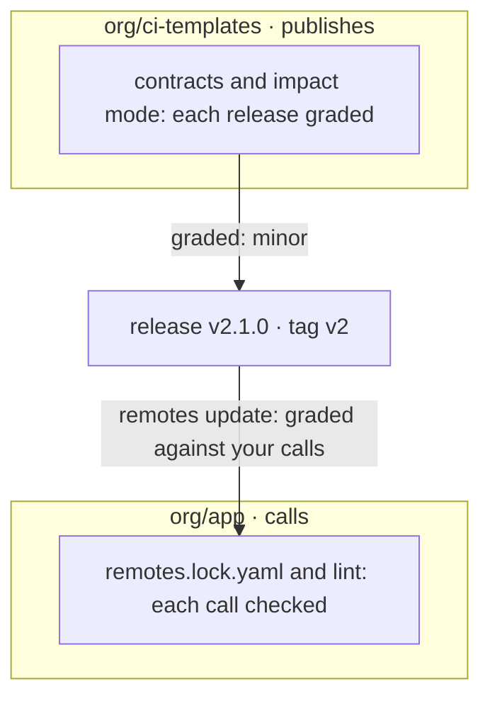

flowpact checks both sides of every interface between GitHub Actions workflows. A reusable workflow or action is an
interface: its inputs, secrets, outputs and the check names its jobs report. The repositories that call it pin a tag
such as `@v1`, and a change that breaks them raises no error where it is made.

- **When you publish one,** flowpact grades every pull request major, minor, patch or none against what callers can
  see, check names included, and fails it when its title declares less.
- **When you call one,** it checks every call against the interface of the version it targets, recorded in a lockfile,
  and grades a version bump or a tag that moved against your calls before you take it.
- **Inside a repository,** it follows every input, secret, env var, matrix key and output across reusable workflows,
  composite actions and matrix combinations. GitHub turns a missing one into an empty string, with no error and a
  green run, and flowpact reports where.



It runs as you type, in your terminal and on every pull request, from the same engine.

## Is this for me?

flowpact earns its place once workflows call each other, or other repositories call yours:

- you publish reusable workflows or actions that other repositories call, and must not break them;
- you call workflows and actions in other repositories, and Renovate or Dependabot move them to new versions;
- reusable workflows and composite actions pass values down through several levels, and outputs back up;
- a matrix with `include` entries feeds a reusable workflow, and every leg must get every value.

A few standalone workflows with no calls between them? [actionlint](https://github.com/rhysd/actionlint) alone may be
enough. flowpact checks what passes between files and matrix combinations: use it next to actionlint, which checks each
file in depth, and [zizmor](https://github.com/zizmorcore/zizmor), which checks security. See
[flowpact and other tools](/docs/comparison).

## Try it

<Tabs items={['Terminal', 'GitHub Action', 'Editor']} groupId="surface" persist>
  <Tab value="Terminal">
    Run it at the root of a repository; there is nothing to configure:

    ```sh
    npx flowpact lint
    ```

    When your workflows call workflows or actions in other repositories, record their interfaces once, and those calls
    are checked too:

    ```sh
    npx flowpact remotes update   # writes .github/flowpact/remotes.lock.yaml: commit it
    npx flowpact lint
    ```

    The [Quickstart](/docs/getting-started) explains the output.
  </Tab>
  <Tab value="GitHub Action">
    ```yaml title=".github/workflows/flowpact.yml"
    name: flowpact
    on: pull_request
    permissions:
      contents: read
    jobs:
      flowpact:
        runs-on: ubuntu-latest
        steps:
          - uses: actions/checkout@v7       # pin to a commit SHA
          - uses: ciatlas/flowpact@v0.22    # pin to a commit SHA
    ```

    Findings become annotations on the pull request and a job summary. See [Run on pull requests](/docs/ci).
  </Tab>
  <Tab value="Editor">
    Install flowpact from the
    [Visual Studio Marketplace](https://marketplace.visualstudio.com/items?itemName=flowpact.vscode-flowpact) or
    [Open VSX](https://open-vsx.org/extension/flowpact/vscode-flowpact). Findings appear as you type, for open and
    closed files, and hovering an input, secret or output shows where it comes from. Neovim and other editors run
    `flowpact lsp`: see [Editors](/docs/editors).
  </Tab>
</Tabs>

## What it checks

- **For publishers.** [Contracts](/docs/contracts) record the interface of every workflow and local action, so a change
  that breaks a caller shows in review, and [impact mode](/docs/impact-mode) fails a pull request that declares a patch
  for a change that needs a major release.
- **Calls into other repositories.** Against a committed lockfile of their interfaces: a required input not passed, an
  unknown input or secret, a literal of the wrong type, an output that is not declared. See
  [Remote interfaces](/docs/remote-interfaces).
- **Across versions.** A version bump or a moved tag that drops an input you pass: `flowpact remotes update` says what
  each changed reference does to your calls, and the action grades the references a pull request moves to another
  version. See [When a version changes](/docs/remote-interfaces#when-a-version-changes).
- **Within your repository.** 53 rules over the data-flow graph: an input a caller never passes, a secret a callee
  never gets, an output nobody sets, a matrix leg that gets nothing, a local action that is not there, and call chains
  GitHub rejects. Each [rule](/docs/rules) has a stable code, why it matters and how to fix it.

flowpact reads your YAML and runs nothing from it, works without a config file, and sends no telemetry.
[How it works](/docs/how-it-works) walks through the analysis, and [Concepts](/docs/concepts) defines the terms these
pages use.

## I want to…

<Cards>
  <Card title="Stop breaking the repositories that use my workflows" href="/docs/shared-workflows">Contracts and impact mode for what you publish.</Card>
  <Card title="Know what a version bump does to my calls" href="/docs/remote-interfaces#when-a-version-changes">A drift check on a schedule, and a verdict on each bot pull request.</Card>
  <Card title="Check calls to other repositories" href="/docs/remote-interfaces">A lockfile of their interfaces, checked offline.</Card>
  <Card title="Find problems in my workflows" href="/docs/getting-started">Run it once and read a finding.</Card>
  <Card title="See findings while I edit" href="/docs/editors">VS Code, VSCodium, Cursor, Neovim and other LSP editors.</Card>
  <Card title="Run it on every pull request" href="/docs/ci">The GitHub Action, or the CLI in any CI.</Card>
  <Card title="Look up a finding" href="/docs/rules">Every rule, from FP101 to FP903.</Card>
  <Card title="Fix a problem with flowpact" href="/docs/troubleshooting">Nothing to analyze, no findings in the editor, a reference that is not fetched.</Card>
  <Card title="Roll it out across my organization" href="/docs/integrating">Organization defaults and rules, in an action of your own.</Card>
  <Card title="Review flowpact's security" href="/docs/security">What it reads and writes, signed releases, the threat model.</Card>
</Cards>
