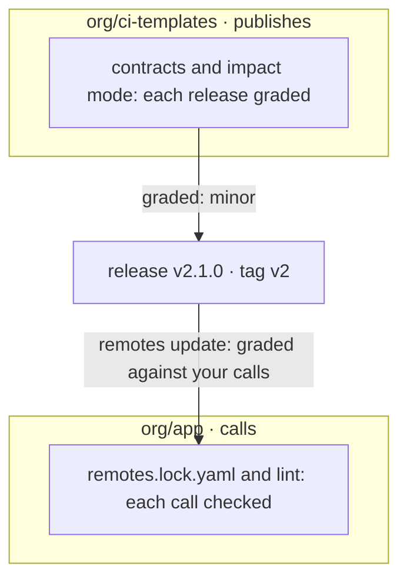

flowpact checks both sides of a reusable workflow or action: what it declares, and what its callers pass and read.

- **You publish one:** each pull request is graded major, minor, patch or none against what callers use
  ([contracts](/docs/contracts), [impact mode](/docs/impact-mode)).
- **You call one:** each call is checked against the version it targets, and each version bump before you take it
  ([remote interfaces](/docs/remote-interfaces)).
- **Inside a repository:** every value is followed across workflows, actions and matrix combinations. GitHub turns a
  missing one into an empty string and a green run; [57 rules](/docs/rules) report where.



It runs in your editor, your terminal and on every pull request. It reads your YAML and runs nothing from it, needs no
config, and sends no telemetry.

## Is this for me?

flowpact earns its place once workflows call each other, or other repositories call yours:

- you publish reusable workflows or actions that other repositories call, and must not break them;
- you call workflows and actions in other repositories, and Renovate or Dependabot move them to new versions;
- reusable workflows and composite actions pass values down through several levels, and outputs back up;
- a matrix with `include` entries feeds a reusable workflow, and every leg must get every value.

A few standalone workflows with no calls between them? [actionlint](https://github.com/rhysd/actionlint) alone may be
enough. Otherwise, use flowpact next to actionlint and [zizmor](https://github.com/zizmorcore/zizmor): see
[flowpact and other tools](/docs/comparison).

## Try it

<Tabs items={['Terminal', 'GitHub Action', 'Editor']} groupId="surface" persist>
  <Tab value="Terminal">
    Run it at the root of a repository; there is nothing to configure:

    ```sh
    npx flowpact lint
    ```

    When your workflows call workflows or actions in other repositories, record their interfaces once, and those calls
    are checked too:

    ```sh
    npx flowpact remotes update   # writes .github/flowpact/remotes.lock.yaml: commit it
    npx flowpact lint
    ```

    The [Quickstart](/docs/getting-started) explains the output.
  </Tab>
  <Tab value="GitHub Action">
    ```yaml title=".github/workflows/flowpact.yml"
    name: flowpact
    on: pull_request
    permissions:
      contents: read
    jobs:
      flowpact:
        runs-on: ubuntu-latest
        steps:
          - uses: actions/checkout@v7       # pin to a commit SHA
          - uses: ciatlas/flowpact@v0.28    # pin to a commit SHA
    ```

    Findings become annotations on the pull request and a job summary. See [Run on pull requests](/docs/ci).
  </Tab>
  <Tab value="Editor">
    Install flowpact from the
    [Visual Studio Marketplace](https://marketplace.visualstudio.com/items?itemName=flowpact.vscode-flowpact) or
    [Open VSX](https://open-vsx.org/extension/flowpact/vscode-flowpact). Findings appear as you type, for open and
    closed files, and hovering an input, secret or output shows where it comes from. Neovim and other editors run
    `flowpact lsp`: see [Editors](/docs/editors).
  </Tab>
</Tabs>

## I want to…

<Cards>
  <Card title="Stop breaking the repositories that use my workflows" href="/docs/shared-workflows">Contracts and impact mode for what you publish.</Card>
  <Card title="Know what a version bump does to my calls" href="/docs/remote-interfaces#when-a-version-changes">A drift check on a schedule, and a verdict on each bot pull request.</Card>
  <Card title="Check calls to other repositories" href="/docs/remote-interfaces">A lockfile of their interfaces, checked offline.</Card>
  <Card title="Find problems in my workflows" href="/docs/getting-started">Run it once and read a finding.</Card>
  <Card title="See findings while I edit" href="/docs/editors">VS Code, VSCodium, Cursor, Neovim and other LSP editors.</Card>
  <Card title="Run it on every pull request" href="/docs/ci">The GitHub Action, or the CLI in any CI.</Card>
  <Card title="Look up a finding" href="/docs/rules">Every rule, from FP101 to FP903.</Card>
  <Card title="Fix a problem with flowpact" href="/docs/troubleshooting">Nothing to analyze, no findings in the editor, a reference that is not fetched.</Card>
  <Card title="Roll it out across my organization" href="/docs/integrating">Organization defaults and rules, in an action of your own.</Card>
  <Card title="Review flowpact's security" href="/docs/security">What it reads and writes, signed releases, the threat model.</Card>
</Cards>

**For AI assistants:** [llms.txt](/llms.txt) lists every page as Markdown, and [llms-full.txt](/llms-full.txt) holds
them all in one file.
