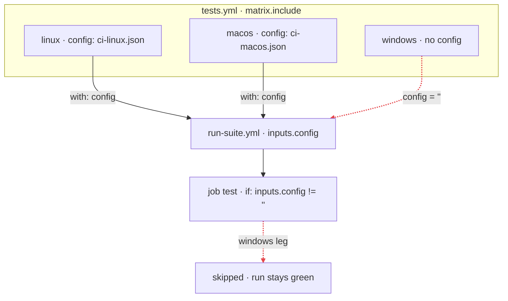

flowpact is a data-flow linter for GitHub Actions. It follows every input, secret, env var, matrix key and output
through reusable workflows, composite actions and calls into other repositories, evaluates every combination of the
matrices in your YAML, and shows where a value goes missing: as you type, in your terminal and on every pull request.

GitHub does not fail a run when a value is missing. A matrix entry without a key, an optional input without a default,
a secret the callee never declared: each evaluates to an empty string. There is no error and no warning, the run is
green, and a job quietly did less than you think, or did not run at all.



<Screenshot name="lint-incident" alt="flowpact lint reporting FP401: input config is empty for the windows matrix combination" caption="The incident that started flowpact: one matrix entry had no config, so its tests never ran, and the run stayed green." />

## Is this for me?

flowpact earns its place once workflows call each other:

- reusable workflows and composite actions pass values down through several levels, and outputs back up;
- a matrix with `include` entries feeds a reusable workflow, and every leg must get every value;
- you call workflows and actions in other repositories, and Renovate or Dependabot move them to new versions;
- you publish reusable workflows or actions that other repositories call, and must not break them.

A few standalone workflows with no calls between them? [actionlint](https://github.com/rhysd/actionlint) alone may be
enough. flowpact checks what passes between files and matrix combinations: use it next to actionlint, which checks each
file in depth, and [zizmor](https://github.com/zizmorcore/zizmor), which checks security. See
[flowpact and other tools](/docs/comparison).

## Try it

<Tabs items={['Terminal', 'GitHub Action', 'Editor']} groupId="surface" persist>
  <Tab value="Terminal">
    Run it at the root of a repository; there is nothing to configure:

    ```sh
    npx flowpact lint
    ```

    When your workflows call workflows or actions in other repositories, record their interfaces once, and those calls
    are checked too:

    ```sh
    npx flowpact remotes update   # writes .github/flowpact/remotes.lock.yaml: commit it
    npx flowpact lint
    ```

    The [Quickstart](/docs/getting-started) explains the output.
  </Tab>
  <Tab value="GitHub Action">
    ```yaml title=".github/workflows/flowpact.yml"
    name: flowpact
    on: pull_request
    permissions:
      contents: read
    jobs:
      flowpact:
        runs-on: ubuntu-latest
        steps:
          - uses: actions/checkout@v7       # pin to a commit SHA
          - uses: ciatlas/flowpact@v0.20    # pin to a commit SHA
    ```

    Findings become annotations on the pull request and a job summary. See [Run on pull requests](/docs/ci).
  </Tab>
  <Tab value="Editor">
    Install flowpact from the
    [Visual Studio Marketplace](https://marketplace.visualstudio.com/items?itemName=flowpact.vscode-flowpact) or
    [Open VSX](https://open-vsx.org/extension/flowpact/vscode-flowpact). Findings appear as you type, for open and
    closed files, and hovering an input, secret or output shows where it comes from. Neovim and other editors run
    `flowpact lsp`: see [Editors](/docs/editors).
  </Tab>
</Tabs>

## What it checks

- **Within your repository.** 53 rules over the data-flow graph: an input a caller never passes, a secret a callee
  never gets, an output nobody sets, a matrix leg that gets nothing, a local action that is not there, and call chains
  GitHub rejects. Each [rule](/docs/rules) has a stable code, why it matters and how to fix it.
- **Calls into other repositories.** Against a committed lockfile of their interfaces: a required input not passed, an
  unknown input or secret, a literal of the wrong type, an output that is not declared. See
  [Remote interfaces](/docs/remote-interfaces).
- **Across versions.** A version bump or a moved tag that drops an input you pass: `flowpact remotes update` says what
  each changed reference does to your calls, and the action grades the references a pull request moves to another
  version. See [When a version changes](/docs/remote-interfaces#when-a-version-changes).
- **For publishers.** [Contracts](/docs/contracts) record the interface of every workflow and local action, so a change
  that breaks a caller shows in review, and [impact mode](/docs/impact-mode) fails a pull request that declares a patch
  for a change that needs a major release.

flowpact reads your YAML and runs nothing from it, works without a config file, and sends no telemetry.
[How it works](/docs/how-it-works) walks through the analysis, and [Concepts](/docs/concepts) defines the terms these
pages use.

## I want to…

<Cards>
  <Card title="Find problems in my workflows" href="/docs/getting-started">Run it once and read a finding.</Card>
  <Card title="See findings while I edit" href="/docs/editors">VS Code, VSCodium, Cursor, Neovim and other LSP editors.</Card>
  <Card title="Run it on every pull request" href="/docs/ci">The GitHub Action, or the CLI in any CI.</Card>
  <Card title="Check calls to other repositories" href="/docs/remote-interfaces">A lockfile of their interfaces, checked offline.</Card>
  <Card title="Know what a version bump does to my calls" href="/docs/remote-interfaces#when-a-version-changes">A drift check on a schedule, and a verdict on each bot pull request.</Card>
  <Card title="Stop breaking the repositories that use my workflows" href="/docs/contracts">Contracts and impact mode for what you publish.</Card>
  <Card title="Look up a finding" href="/docs/rules">Every rule, from FP101 to FP903.</Card>
  <Card title="Roll it out across my organization" href="/docs/integrating">Organization defaults and rules, in an action of your own.</Card>
  <Card title="Review flowpact's security" href="/docs/security">What it reads and writes, signed releases, the threat model.</Card>
</Cards>
