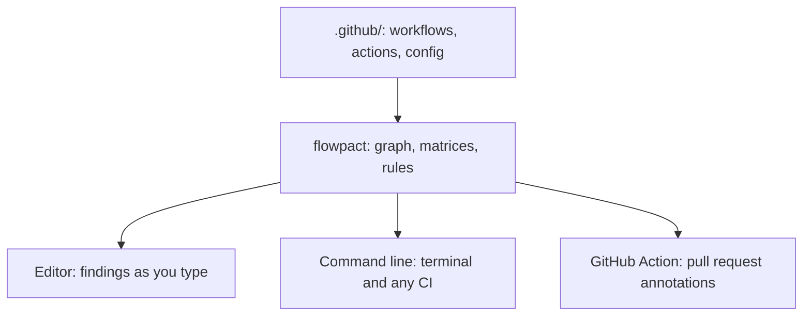

flowpact runs in three places, from the same engine: they read the same files and report the same findings.



## Command line

The npm package and the command are both `flowpact`; it needs Node.js 22 or newer. To try it without installing
anything, run it with `npx` at the root of a repository:

```sh
npx flowpact lint
```

To pin the version for everyone working on the repository, and for its CI, add it as a development dependency:

```npm
npm i -D flowpact
```

<Tabs items={['Global', 'One version', 'mise']}>
  <Tab value="Global">
    Install once and use `flowpact` anywhere:

    ```sh
    npm install --global flowpact
    flowpact lint
    ```
  </Tab>
  <Tab value="One version">
    Run a given version without installing it:

    ```sh
    npx flowpact@0.27 lint
    ```
  </Tab>
  <Tab value="mise">
    ```sh
    mise use --global npm:flowpact
    flowpact lint
    ```
  </Tab>
</Tabs>

## GitHub Actions

The action needs neither Node.js nor an install step: it runs the bundled engine and turns findings into annotations on
the pull request and a job summary.

```yaml title=".github/workflows/flowpact.yml"
name: flowpact
on: pull_request
permissions:
  contents: read
jobs:
  flowpact:
    runs-on: ubuntu-latest
    steps:
      - uses: actions/checkout@v7       # pin to a commit SHA
      - uses: ciatlas/flowpact@v0.27    # pin to a commit SHA
```

[Run on pull requests](/docs/ci) covers the setups for an application repository and for a repository of shared
workflows, and [GitHub Action](/docs/action) lists every input and output. Other CI services run the command line.

## Editors

<Tabs items={['VS Code', 'Open VSX', 'Without a marketplace', 'Other editors']}>
  <Tab value="VS Code">
    Install **flowpact** from the
    [Visual Studio Marketplace](https://marketplace.visualstudio.com/items?itemName=flowpact.vscode-flowpact). The
    extension bundles the language server: it needs neither Node.js nor the npm package.
  </Tab>
  <Tab value="Open VSX">
    In VSCodium, Cursor, Windsurf and other editors built on VS Code, install **flowpact** from
    [Open VSX](https://open-vsx.org/extension/flowpact/vscode-flowpact).
  </Tab>
  <Tab value="Without a marketplace">
    Each release attaches the extension as a `.vsix` file: see
    [Install without a marketplace](/docs/editors#install-without-a-marketplace).
  </Tab>
  <Tab value="Other editors">
    Neovim and other editors with a Language Server Protocol client run `flowpact lsp` from the npm package: see
    [Other editors](/docs/editors#other-editors).
  </Tab>
</Tabs>

## Verify a release

Each release is built by the repository's release workflow, which attests the npm package, the action and the
extension, with an SBOM; the npm package is published with provenance. See
[Verify a release](/docs/security#verify-a-release).

<Cards>
  <Card title="Quickstart" href="/docs/getting-started">Run it on a repository and read a finding.</Card>
  <Card title="Adopt it in an existing repository" href="/docs/adopting">A first run with many findings.</Card>
</Cards>
