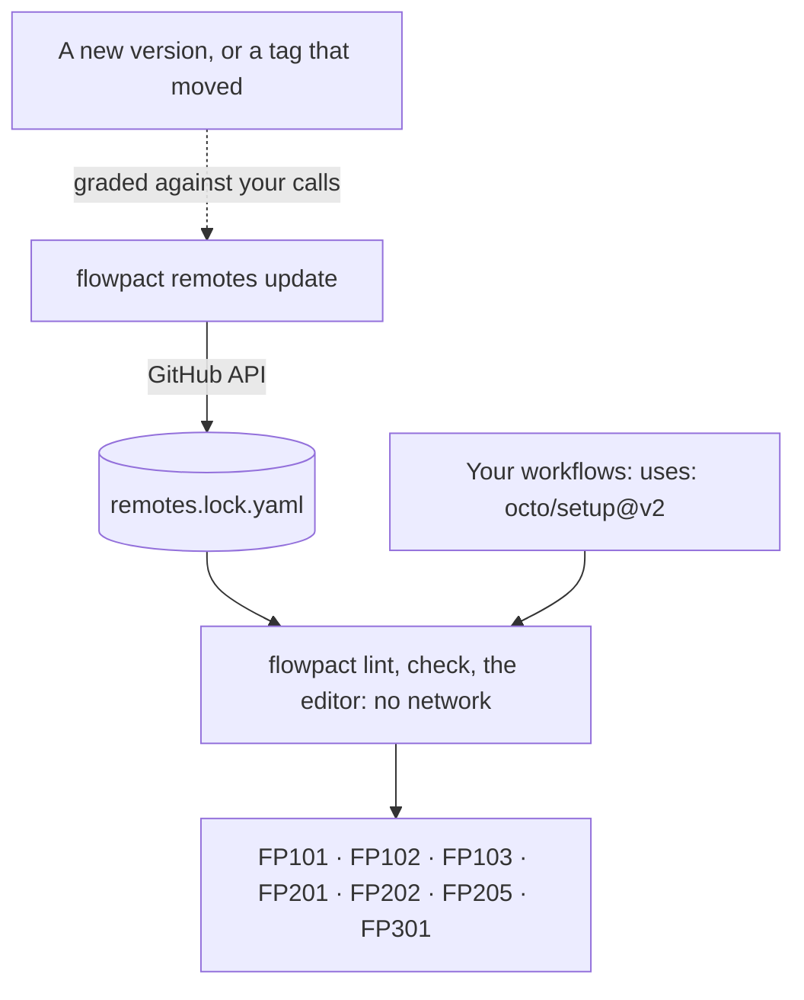

flowpact analyzes one repository. A call to a reusable workflow or an action in another repository
(`uses: octo/ship/.github/workflows/deploy.yml@v1`, `uses: octo/setup@v2`) is taken on trust: nothing checks that the
inputs you pass exist, have the right type, or include the required ones ([`FP603`](/docs/rules/fp603) says so for
remote workflows).

A **remote interfaces lockfile** records the interface of each one: its inputs, secrets and outputs, at the commit a
reference resolved to.



<Callout title="Interfaces, not pins">
  The lockfile records what each reference accepts and returns, so flowpact can check your calls. It does not decide
  which commit runs: pin references to commit SHAs, or use GitHub's [`actions.lock`](#githubs-actionslock), which
  flowpact reads.
</Callout>

With it, flowpact checks remote calls as it checks local ones:

- [`FP101`](/docs/rules/fp101): a required input is not passed;
- [`FP102`](/docs/rules/fp102): an input that the workflow or action does not declare is passed;
- [`FP103`](/docs/rules/fp103): a literal of the wrong type is passed to a `boolean` or `number` input;
- [`FP201`](/docs/rules/fp201): a required secret is not passed to a remote reusable workflow;
- [`FP202`](/docs/rules/fp202): a secret it does not declare is passed;
- [`FP205`](/docs/rules/fp205): a remote reusable workflow reads a secret it does not declare (relying on
  `secrets: inherit`), and your call does not use `secrets: inherit`, so the secret is empty. `flowpact remotes update`
  records such secrets as `undeclaredSecrets` when it reads the workflow, only reads that run on every call: a read
  under an `if:` (on its step, its job, or a job its job needs), or in a condition, is left out, since a caller's
  inputs, event or environment may switch it off. Not followed: a secret the remote workflow hands on with its own
  `secrets: inherit`, and `inherit` from a workflow of yours that was itself given secrets by name;
- [`FP301`](/docs/rules/fp301): an output it does not declare is read (`needs.<job>.outputs.<name>`,
  `steps.<id>.outputs.<name>`). A JavaScript or Docker action may set outputs it does not declare, so only a
  composite action's are checked.

Otherwise, what a remote workflow does with what it gets is not checked: its jobs and steps are in another repository,
so rules about what a callee reads ([`FP203`](/docs/rules/fp203), [`FP204`](/docs/rules/fp204), [`FP106`](/docs/rules/fp106))
stay quiet about it.

Findings point at your call; the message names the remote reference, whose file is in another repository. Nothing is
fetched during a run: flowpact reads only the committed lockfile, so results do not depend on the network.

<Screenshot name="lint-remote" alt="flowpact lint reporting FP102, octo/setup@v2 has no input cache-dependency (did you mean cache-dependency-path), and FP101, jobs.deploy calls octo/ship's deploy workflow without required input environment" caption="Two calls into other repositories, checked against the lockfile: a misspelled input and a missing required one." />

In the editor, [hovering](/docs/editors#hover) a remote `uses:` value, or a key a remote call passes, shows the
interface the lockfile records.

## Writing it

```sh
flowpact remotes update                                   # every remote reference
flowpact remotes update .github/workflows/release.yml     # only what release.yml (and what it calls) uses
```

[`flowpact remotes update`](/docs/cli#flowpact-remotes-update) resolves every remote reference the repository uses to
a commit, reads its workflow file or `action.yml` there through the GitHub API, and writes the lockfile. Commit it, and
run it again when you move a reference to another version, or on a schedule to notice a tag that moved: it says what
each changed entry does to your calls ([When a version changes](#when-a-version-changes)). In a terminal
it counts the references as it fetches them; `-v` or `-d` logs a line for each instead, with the commit it resolved to
or why it could not be fetched. It also keeps the files it reads in your [sources cache](#sources-for-the-editor), so
the editor can open them.

A program can do the same with [`remotesUpdate()`](/docs/api#remotesupdate-remotesdownload-and-remotesclean) from the
API, and read what changed and what failed from its result.

### Which token

| Token | Read from |
| --- | --- |
| `GH_TOKEN` | first, when set |
| `GITHUB_TOKEN` | when `GH_TOKEN` is not set |
| the GitHub CLI's (`gh auth token`) | when neither is set, for github.com |
| none | public repositories only, at GitHub's 60 requests an hour for anonymous reads |

The output starts with the source it used (`token: GH_TOKEN`); the token itself is never printed, and it is sent only to
the GitHub API (`GITHUB_API_URL` on GitHub Enterprise Server). Public repositories need no permission. Private and
internal ones need read access to their contents: a fine-grained token with **Contents: read** on those repositories,
a classic token with `repo`, or a GitHub App installation token that includes them.

### When a reference is not fetched

| Message | What to do |
| --- | --- |
| `not found, or not readable with this token` | The reference does not exist, or the token cannot read it. It is recorded under `unreadable:`; give a token that can read it to check it. |
| `the GitHub API rejected the token (401)` | The token is invalid or expired: check `GH_TOKEN` or `GITHUB_TOKEN`, or run `gh auth status`. |
| `the GitHub API rate limit is used up` | Without a token GitHub allows 60 requests an hour: set a token, or wait. |
| `the GitHub API asks to slow down` | GitHub's secondary rate limit, for many requests at once: try again when it says. |
| `the GitHub API refused the request (403)` | The token lacks read access to that repository's contents. |
| `could not reach https://api.github.com (…)` | Node's `fetch failed`: no network, DNS, TLS or a proxy. Check `GITHUB_API_URL`; behind a proxy, set `HTTPS_PROXY` with `NODE_USE_ENV_PROXY=1` (Node 24 and later), as Node's fetch ignores proxy variables otherwise. |
| `no answer from … within 30 s` | The network or the API is slow: try again. |

Before it gives up on a reference, flowpact sends a request again after no answer, a server error (5xx) or the
secondary rate limit, three times at most and waiting longer each time (as long as the rate limit asks, up to a
minute), and asks once more for a commit or file the API says is not there, which it now and then says of one it has.
An invalid token, missing access and a used-up rate limit are not tried again.

## Sources for the editor

The lockfile holds interfaces only. The files they were read from, the remote workflow files and `action.yml`s, go to
a cache of your own, outside the repository, so the [editor](/docs/editors) can open them:
`flowpact remotes update` keeps every file it reads there, and `flowpact remotes download` fills it for a lockfile
someone else wrote, say after a `git pull`:

```sh
flowpact remotes download                                 # every remote reference the lockfile pins
flowpact remotes download .github/workflows/release.yml   # only what release.yml (and what it calls) uses
```

[`flowpact remotes download`](/docs/cli#flowpact-remotes-download) reads each file at the commit the lockfile pins:
it resolves no tag and does not change the lockfile, so the editor shows the version the checks used. It skips what
the cache has, and needs the same [token](#which-token) as `remotes update`.

| Platform | Cache |
| --- | --- |
| Linux and others | `$XDG_CACHE_HOME/flowpact/remotes`, or `~/.cache/flowpact/remotes` |
| macOS | `~/Library/Caches/flowpact/remotes` |
| Windows | `%LOCALAPPDATA%\flowpact\Cache\remotes` |

`--cache-dir <dir>` (relative to where you run flowpact) or `FLOWPACT_CACHE_DIR` (an absolute path) moves it to
`<dir>/remotes`; point your editor at the same place (see [Editors](/docs/editors)). Files are kept by repository and
commit (`octo/ship/<sha>/.github/workflows/deploy.yml`), read-only. A file at a commit never changes, so nothing in
the cache goes stale; one cache serves every repository on the machine, and you can delete any of it at any time.
Two versions of one action (`octo/setup@v1` in one job, `@v2` in another) are two lockfile entries and two commits in
the cache, each call checked against its own version.

The cache stays small on its own: after `remotes update` and `remotes download`, each repository they used keeps its
3 most recently used commits (never one the run used). `flowpact remotes clean` empties it, and
`flowpact remotes clean --keep 2` keeps the 2 most recently used commits of each repository. Cleaning removes only the
commits flowpact keeps there (`<owner>/<repo>/<sha>` directories), nothing else in the directory.
Files of private and internal repositories land there too, readable by your user only: flowpact creates the cache's
files and directories for you alone, wherever it is. A reference whose path could not be a file name on every platform
(`..`, a character Windows rejects) is not cached.

**In CI**, nobody opens the files, so `remotes update` keeps none there (when `CI` is set, as GitHub Actions, GitLab,
CircleCI and most CI services set it, or Azure Pipelines' `TF_BUILD` or Jenkins' `JENKINS_URL`) unless `--cache-dir`
or `FLOWPACT_CACHE_DIR` says where; the output says it kept none. `remotes update --no-cache` keeps none anywhere. The
action never writes the cache, and neither does `--fetch-remotes` or `--dry-run`. Without a home directory and without either option, `remotes update` keeps nothing
and `remotes download` stops with a usage error.

## GitHub Enterprise Server and GHE.com

flowpact reads every remote reference from one API: `GITHUB_API_URL`, else `https://api.github.com`. It does not guess
the host from the references.

- **In CI**, the runner sets `GITHUB_API_URL` (`https://<host>/api/v3` on GitHub Enterprise Server,
  `https://api.<subdomain>.ghe.com` on GHE.com), so the action reads from your enterprise with `token`.
- **On your machine**, set it yourself: `export GITHUB_API_URL=https://<host>/api/v3`. The token is `GH_TOKEN`,
  `GITHUB_TOKEN`, or the GitHub CLI's for that host (`gh auth login --hostname <host>`).

**Actions from github.com.** With GitHub Connect, a runner of GitHub Enterprise Server looks for an action on the
enterprise server first, then on github.com. flowpact asks only the enterprise server unless you opt in, so an action
the runner takes from github.com is recorded under `unreadable:`. To look on github.com too:

```sh
flowpact remotes update --github-com          # GITHUB_COM_TOKEN for github.com, or none
```

```yaml
- uses: ciatlas/flowpact@v0.23
  with:
    remotes: fetch
    remotes-github-com: true
    github-com-token: ${{ secrets.GITHUB_COM_TOKEN }}   # optional; public repositories need none
```

Entries read from github.com are marked `host: github.com`. The enterprise token is never sent to github.com: it is read
with `GITHUB_COM_TOKEN` (the action's `github-com-token`), or without a token. It is opt-in because it sends the names
of the references your enterprise server lacks to github.com, internal ones that are misspelled or deleted included.

## In CI

The [action](/docs/action) and the CLI read the committed lockfile and nothing else. To also check references the
lockfile lacks, opt in to fetching them for the run: nothing is written back, and the lockfile's own entries stand.

```yaml title=".github/workflows/flowpact.yml"
- uses: ciatlas/flowpact@v0.23
  with:
    remotes: fetch            # token defaults to github.token
```

On the command line, `flowpact lint --fetch-remotes` (or `check`) does the same with `GH_TOKEN`, `GITHUB_TOKEN` or the
GitHub CLI's token. A reference that cannot be fetched is a warning and stays unchecked. The job's `github.token` reads
public repositories; private and internal ones of your organization need a token that can read them (a GitHub App
installation token, for example from `actions/create-github-app-token` with their names under `repositories:`).

The action does not fetch on `pull_request_target` or `workflow_run`: there the workflows come from an untrusted
pull request while the token may be privileged, so the pull request would choose which repositories the token reads,
and the findings would show what it read.

A lockfile that lacks a reference the repository uses, or has one nothing uses, is reported by
[`FP612`](/docs/rules/fp612) (a warning), also when the run fetched it: run `flowpact remotes update` and commit it.

A reference pinned to a full commit SHA (`octo/setup@<sha>`) runs that commit, whatever the lockfile says.
`flowpact remotes update` records that same commit for it; an entry that records another one was edited by hand, and
describes other code than what runs. flowpact does not check calls against such an entry (they are unverified, as
without one), and FP612 reports it.

## When a version changes

A tag moves, or you move a reference to another version, and the new interface may drop an input your calls pass, make
one required, or stop declaring an output you read. `flowpact remotes update` grades each changed entry against every
call of its reference in the repository, before you commit the new lockfile (with `--dry-run`, before it writes
anything):

```text
would write .github/flowpact/remotes.lock.yaml
token: GH_TOKEN
  changed actions/setup-node@v6: 2028fbc → 395ad32, breaks 1 of 3 calls
    input "always-auth" was removed — steps that pass it get a warning, and their value is ignored
    breaks .github/workflows/release.yml:21 jobs.publish step #2
      FP102 actions/setup-node@v6 has no input "always-auth"
    2 other calls fit
```

That one is real: setup-node 6.1.0 dropped `always-auth`, and `@v6` moved to it. Each call gets a verdict:

| Verdict | Meaning |
| --- | --- |
| breaks | A check fails with the new interface that passed with the old one. The lines under it are what `flowpact check` reports once the lockfile is updated. |
| not fully checked | No check fails, but part of the change is out of the checks' reach for this call; the line under it says which. |
| fits | Every check passes as before. Only the calls that do not simply fit are listed. |

The verdict comes from the rules this page starts with (FP101 to FP103, FP201, FP202, FP205 and FP301), run with the
entry before and after; the interface diff under the reference explains it, and problems a call already had do not
count. A call is **not fully checked**
when:

- it passes an expression to an input the new version declares as a `boolean` or `number`: only literal values are
  checked ([`FP103`](/docs/rules/fp103));
- it uses `secrets: inherit`, and the new version needs a secret the old one did not: whether your repository or
  organization has it is not known;
- it reads an output the new version no longer declares, of a JavaScript or Docker action, which can still set it.

A note follows a call that leaves out an input whose default changed: it runs with the new default. A change of an
action's runtime (`runs.using`, such as `node20` to `node24`) is listed under the reference. The grade is about the
interface, not the behaviour: a release that keeps its inputs but changes what they do fits your calls, so read the
release notes of a major version.

### A scheduled drift check

To hear about a moved tag before a run fails, check on a schedule. `--fail-on breaks` makes the job fail when a changed
entry breaks a call; `--fail-on unchecked` also when it leaves part of one unchecked:

```yaml title=".github/workflows/remotes-drift.yml"
name: Remote interfaces drift
on:
  schedule:
    - cron: '0 6 * * 1'
  workflow_dispatch:
permissions:
  contents: read
jobs:
  drift:
    runs-on: ubuntu-latest
    steps:
      - uses: actions/checkout@v7                       # pin to a commit SHA
        with:
          persist-credentials: false
      - run: npx --yes flowpact@0.23 remotes update --dry-run --fail-on breaks
        env:
          GH_TOKEN: ${{ github.token }}
```

When a tag the lockfile records has moved to a commit that drops an input your workflow passes, the job fails with:

<Screenshot name="remotes-update" alt="flowpact remotes update --dry-run --fail-on breaks: octo/setup@v2 changed from e3b1c7a to 9d4e2f1 and breaks 1 of 1 call, because input registry-auth was removed and release.yml passes it" caption="The tag octo/setup@v2 moved: the new commit no longer has the input release.yml passes." />

`github.token` reads public repositories; private and internal ones need a token that can read them
([Which token](#which-token)). With `--format json`, the same comes as JSON for a script: `grades` has one entry per
changed reference, with its `verdict`, the interface `changes`, and its `calls`, each with its `verdict`, the findings
it `added`, why it is `unchecked`, and `notes`. [`remotesUpdate()`](/docs/api#remotesupdate-remotesdownload-and-remotesclean)
returns the same.

### On a pull request

With `remotes: fetch`, the [action](/docs/action) also grades the references a pull request moves to another version
(`octo/setup@v2` → `@v3`, the same workflow or action at another ref), and adds a **Version changes** section to the
job summary. The interface before is the base commit's (its lockfile's entry for `@v2`, else `@v2` fetched); the one
after is always fetched, never read from the pull request's own lockfile, which could record one that hides a break. A
version change that breaks a call fails the step (unless `fail-on` is `never`), and the `version-verdict` output says
`breaks`, `unchecked` or `fits`.

## Renovate and Dependabot

When Renovate or Dependabot moves a reference to another version (`octo/setup@v2` → `@v3`), the lockfile still has
`@v2` and lacks `@v3`. Until it is updated, `@v3` is checked only by a run that fetches it, and [`FP612`](/docs/rules/fp612)
says the lockfile is out of date.

**Gate the bump.** With `remotes: fetch` in your flowpact job on pull requests, the bot's pull request is
[graded](#on-a-pull-request): the step fails when `@v3` breaks one of your calls, even when the pull request updates
the lockfile too. Make that job a required status check, and Renovate's `automerge` and GitHub's auto-merge for
Dependabot wait for it:

```yaml title=".github/workflows/flowpact.yml"
on: pull_request
permissions:
  contents: read
jobs:
  flowpact:
    runs-on: ubuntu-latest
    steps:
      - uses: actions/checkout@v7                       # pin to a commit SHA
        with:
          persist-credentials: false
      - uses: ciatlas/flowpact@v0.23                    # pin to a commit SHA
        with:
          remotes: fetch
```

Three ways to keep the lockfile current:

- **Check the pull request anyway.** With `remotes: fetch` in your flowpact job, the bot's pull request is checked
  against `@v3`'s interface, and FP612 reminds you to update the lockfile before merging.
- **Self-hosted Renovate:** update the lockfile in the same pull request with a post-upgrade task. Allow the command in
  the bot's admin config, not in `renovate.json` (`allowedCommands: ["^npx --yes flowpact@"]`, formerly
  `allowedPostUpgradeCommands`), and give it a token that can read the remote repositories through the environment
  Renovate runs commands in (for example `customEnvVariables`):

  ```json title="renovate.json"
  {
    "postUpgradeTasks": {
      "commands": ["npx --yes flowpact@0.23 remotes update"],
      "fileFilters": [".github/flowpact/remotes.lock.yaml"],
      "executionMode": "branch"
    }
  }
  ```

- **The Renovate app or Dependabot**, which run no commands of yours: a workflow on their pull requests runs the update
  and pushes the lockfile to their branch. Push with a GitHub App token rather than `github.token`, whose pushes start
  no workflow runs, so the pull request's checks run again on the new commit. Dependabot's runs get a read-only token
  and only Dependabot secrets, so store the app's key as a Dependabot secret.

  ```yaml title=".github/workflows/remotes-lock.yml"
  name: Remote interfaces lockfile
  on:
    pull_request:
      paths: ['.github/workflows/**', '**/action.yml', '**/action.yaml']
  permissions: {}
  jobs:
    update:
      if: contains(fromJSON('["renovate[bot]", "dependabot[bot]"]'), github.event.pull_request.user.login)
      runs-on: ubuntu-latest
      steps:
        - id: app
          uses: actions/create-github-app-token@v3       # pin to a commit SHA
          with:
            client-id: ${{ vars.LOCK_BOT_CLIENT_ID }}
            private-key: ${{ secrets.LOCK_BOT_PRIVATE_KEY }}
        - uses: actions/checkout@v7                       # pin to a commit SHA
          with:
            ref: ${{ github.head_ref }}
            token: ${{ steps.app.outputs.token }}
            persist-credentials: true
        - run: npx --yes flowpact@0.23 remotes update
          env:
            GH_TOKEN: ${{ steps.app.outputs.token }}
        - run: |
            git diff --quiet -- .github/flowpact/remotes.lock.yaml && exit 0
            git config user.name 'remotes-lock[bot]'
            git config user.email 'remotes-lock[bot]@users.noreply.github.com'
            git commit -m 'chore: update the remote interfaces lockfile' -- .github/flowpact/remotes.lock.yaml
            git push
  ```

  The job runs only for the bots' pull requests, checks out their branch (never a fork's: bots push to your
  repository), and runs `flowpact` from npm, not code from the pull request.

## GitHub's actions.lock

GitHub's [workflow dependency lockfile](https://docs.github.com/actions/concepts/security/workflow-dependency-lockfiles),
`.github/workflows/actions.lock` (written by `gh actions-lock`, Dependabot and Renovate), pins the commit each
`owner/repo@ref` runs in the workflows it covers: a tag such as `@v4` keeps running that commit after it moves. The two
files do different jobs:

| | `.github/workflows/actions.lock` | `.github/flowpact/remotes.lock.yaml` |
| --- | --- | --- |
| Written by | `gh actions-lock`, Dependabot, Renovate | `flowpact remotes update` |
| Records | the commit each reference runs, and who owns it | each reference's inputs, secrets and outputs at a commit |
| Used by | the runner, which runs that commit and checks it | flowpact, which checks your calls against the interface |

flowpact reads `actions.lock`, never writes it, and checks each reference at the commit that runs: `remotes update`,
`--fetch-remotes`, the action's `remotes: fetch` and the [pull request grading](#on-a-pull-request) read a reference it
pins at its commit, not at the commit its tag points to now, and `remotes update` says how many it read that way. An
entry of flowpact's lockfile that records another commit is reported by [`FP612`](/docs/rules/fp612): the bot that
updated `actions.lock` left `remotes.lock.yaml` as it was, so run `flowpact remotes update`.

- Only the workflows `actions.lock` lists are covered: a reference it pins for none of them resolves as usual. One
  that a covered and an uncovered workflow both use is read at the pinned commit.
- A reference with a path (`octo/ship/.github/workflows/deploy.yml@v1`, `actions/cache/restore@v4`) is pinned by its
  repository's key (`octo/ship@v1`), as `gh actions-lock` writes it.
- The schema is before 1.0: flowpact reads versions `v0.0.x`. Another version, or a file that does not parse, is not
  used, and `remotes update` says why. Its `hostname` is not read: a reference is fetched as without `actions.lock`.

## The lockfile

`.github/flowpact/remotes.lock.yaml` (or `remotes.lock.yml`), one entry per `uses:` reference:

```yaml title=".github/flowpact/remotes.lock.yaml"
version: 1
remotes:
  octo/ship/.github/workflows/deploy.yml@v1:
    sha: 4e6c5f0b9a1d2e3f4a5b6c7d8e9f0a1b2c3d4e5f   # the commit v1 resolved to
    kind: workflow
    inputs:
      env: { type: string, required: true }
      dry-run: { type: boolean, default: false }
    secrets:
      token: { required: true }
    outputs: [url]
    undeclaredSecrets: [NPM_TOKEN]   # read without being declared: only secrets: inherit gives it
  octo/setup@v2:
    sha: 9f8e7d6c5b4a39281706f5e4d3c2b1a098765432
    kind: action
    using: composite        # runs.using; outputs are checked only for composite
    inputs:
      version: { required: true }
    outputs: [path]
```

A reference `flowpact remotes update` cannot read (it does not exist, or the token cannot read it, as for a private
repository of another organization) is recorded under `unreadable:`, with why. It is not checked, but the lockfile
accounts for it, so [`FP612`](/docs/rules/fp612) does not report it:

```yaml
unreadable:
  vercel/gh-sts-action@c30f0b7a16e0766c4ffbc0d210b54d0e75053fd2: not found, or not readable with this token
```

The owner and repository of a reference match in any letter case, the path and the ref as written. A reference the
lockfile does not have stays unchecked. A lockfile that does not parse or does not match this shape is reported by
[`FP611`](/docs/rules/fp611), and then no remote call is checked.
