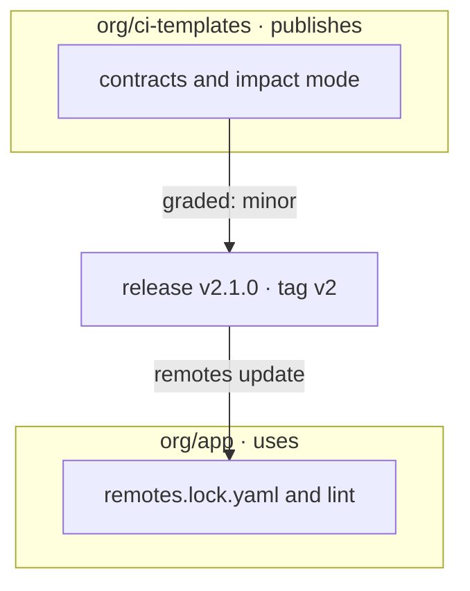

A reusable workflow or action that other repositories call is an interface: its inputs, secrets and outputs, and the
check names its jobs report. The repositories that call it pin a tag such as `@v2` and take every release in it, and
you cannot see their workflows or their branch protection. flowpact checks both sides of that interface.



## When you publish

A **published** workflow or action is one other repositories can use: every reusable workflow but those whose file
name starts with `_`, and the action at the repository's root (see [Concepts](/docs/concepts#published-unit)).

<Cards>
  <Card title="Lock what you publish" href="/docs/contracts">A contract per workflow and action records its interface. A change to it shows as a YAML diff in review, and `flowpact check` fails on a breaking one.</Card>
  <Card title="Grade every release" href="/docs/impact-mode">Impact mode grades a pull request's changes as major, minor, patch or none, and fails it when its title declares less.</Card>
</Cards>

In the GitHub Action, both are inputs:

```yaml title=".github/workflows/flowpact.yml"
on:
  pull_request:
    # edited / labeled: grade again when the title or the labels change
    types: [opened, edited, synchronize, reopened, labeled, unlabeled]
permissions:
  contents: read
jobs:
  flowpact:
    runs-on: ubuntu-latest
    steps:
      - uses: actions/checkout@v7       # pin to a commit SHA
      - uses: ciatlas/flowpact@v0.21    # pin to a commit SHA
        with:
          mode: check    # lint, and compare with the committed contracts
          impact: auto   # grade the change against the pull request title
```

## When you use them

<Cards>
  <Card title="Check what you call" href="/docs/remote-interfaces">Record the interfaces of the workflows and actions you call in a lockfile, and every call is checked against them, with no network during the run.</Card>
  <Card title="Know what a new version does" href="/docs/remote-interfaces#when-a-version-changes">A drift check on a schedule, and a verdict on each pull request that moves a reference to another version.</Card>
</Cards>

```sh
npx flowpact remotes update                          # record the interfaces, then commit the lockfile
npx flowpact remotes update --dry-run --fail-on breaks   # on a schedule: what changed, and what it breaks
```

## Across an organization

[Roll it out across an organization](/docs/integrating): organization defaults in a base config, organization rules as
plugins, and the action wrapped in one of your own.
